# Catálogo de props por tipo

Todos os objetos de cenário do jogo (`assets/ambiente/objetos/`), separados por tipo para reaproveitar em mapas novos.
Gerado por `assets/ambiente/fontes/catalogo.py` (rode de novo depois de publicar peças novas). Cada tipo tem uma prancha
com as miniaturas em `assets/ambiente/catalogo/`. Os dados ficam em `assets/ambiente/catalogo.json`.

Total: **722 peças** em 18 tipos.

Reaproveitar: o id é o `k` do prop no mapa (`{"k": id, "x": .., "y": ..}`); `tiles` é a pegada no chão. Peças com
`descricao` dizem o que são; as de bioma fechado (egito, amenti, torre...) seguem a paleta daquela área, então numa
área de outro tema prefira as de bioma `base` (kit original: deserto, São Lázaro, cripta, que combina com quase tudo).

## Índice

- [Coliseu do Agrak (arquibancadas, plateia, faixas)](#coliseu) · 42 peças · prancha `catalogo/coliseu.png`
- [Peças de chefe e efeitos de ambiente](#chefes_efeitos) · 17 peças · prancha `catalogo/chefes_efeitos.png`
- [Paredes, muros e limites do mapa](#paredes) · 155 peças · prancha `catalogo/paredes.png`
- [Prédios e estruturas grandes](#predios) · 84 peças · prancha `catalogo/predios.png`
- [Colunas, arcos, degraus e peças de arquitetura](#arquitetura) · 21 peças · prancha `catalogo/arquitetura.png`
- [Portas, escadas, elevadores e passagens](#portas) · 25 peças · prancha `catalogo/portas.png`
- [Decalques de chão (manchas, rastros, símbolos)](#decalques) · 40 peças · prancha `catalogo/decalques.png`
- [Vegetação (árvores, arbustos, raízes, fungos)](#vegetacao) · 87 peças · prancha `catalogo/vegetacao.png`
- [Água, rio e barcos](#rio) · 20 peças · prancha `catalogo/rio.png`
- [Rochas, dunas e terreno](#rochas) · 21 peças · prancha `catalogo/rochas.png`
- [Luz e fogo (velas, lampiões, braseiros)](#luz) · 21 peças · prancha `catalogo/luz.png`
- [Religioso e funerário (altares, túmulos, estátuas)](#religioso) · 53 peças · prancha `catalogo/religioso.png`
- [Ossos, corpos e restos](#ossos) · 19 peças · prancha `catalogo/ossos.png`
- [Máquinas, rádio, sucata e trilhos](#maquinas) · 40 peças · prancha `catalogo/maquinas.png`
- [Móveis (mesas, cadeiras, estantes, camas)](#moveis) · 31 peças · prancha `catalogo/moveis.png`
- [Recipientes e cargas (caixotes, barris, vasos)](#recipientes) · 25 peças · prancha `catalogo/recipientes.png`
- [Cercas, estandartes, placas e sinais](#sinais) · 15 peças · prancha `catalogo/sinais.png`
- [Ferramentas e armas](#ferramentas) · 6 peças · prancha `catalogo/ferramentas.png`

## Coliseu do Agrak (arquibancadas, plateia, faixas)

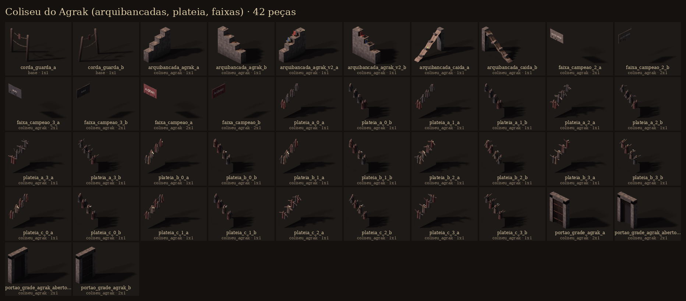

| id | bioma | tiles | o que é |
|---|---|---|---|
| `corda_guarda_a` | base | 1x1 | Estacas com corda de guarda na beira do precipício (segmento de 1 tile). |
| `corda_guarda_b` | base | 1x1 | Estacas com corda de guarda na beira do precipício (segmento de 1 tile). |
| `arquibancada_agrak_a` | coliseu_agrak | 1x1 | Arquibancada do estádio enterrado: 4 degraus de concreto rachado com ferragem exposta e areia nos cantos. |
| `arquibancada_agrak_b` | coliseu_agrak | 1x1 | Arquibancada do estádio enterrado: 4 degraus de concreto rachado com ferragem exposta e areia nos cantos. |
| `arquibancada_agrak_v2_a` | coliseu_agrak | 1x1 | Variação: degrau quebrado, cadeiras de plástico derretidas e um holofote caído. |
| `arquibancada_agrak_v2_b` | coliseu_agrak | 1x1 | Variação: degrau quebrado, cadeiras de plástico derretidas e um holofote caído. |
| `arquibancada_caida_a` | coliseu_agrak | 1x1 | Arquibancada que desabou: rampa de areia escorrendo do alto dos degraus até o fosso, com lajes de degrau tombadas meio enterradas e ferragem para… |
| `arquibancada_caida_b` | coliseu_agrak | 1x1 | Arquibancada que desabou: rampa de areia escorrendo do alto dos degraus até o fosso, com lajes de degrau tombadas meio enterradas e ferragem para… |
| `faixa_campeao_2_a` | coliseu_agrak | 2x1 |  |
| `faixa_campeao_2_b` | coliseu_agrak | 2x1 |  |
| `faixa_campeao_3_a` | coliseu_agrak | 2x1 |  |
| `faixa_campeao_3_b` | coliseu_agrak | 2x1 |  |
| `faixa_campeao_a` | coliseu_agrak | 2x1 | Faixa de pano rasgada com nome pintado (para pendurar no muro do fosso). |
| `faixa_campeao_b` | coliseu_agrak | 2x1 | Faixa de pano rasgada com nome pintado (para pendurar no muro do fosso). |
| `plateia_a_0_a` | coliseu_agrak | 1x1 |  |
| `plateia_a_0_b` | coliseu_agrak | 1x1 |  |
| `plateia_a_1_a` | coliseu_agrak | 1x1 |  |
| `plateia_a_1_b` | coliseu_agrak | 1x1 |  |
| `plateia_a_2_a` | coliseu_agrak | 1x1 |  |
| `plateia_a_2_b` | coliseu_agrak | 1x1 |  |
| `plateia_a_3_a` | coliseu_agrak | 1x1 |  |
| `plateia_a_3_b` | coliseu_agrak | 1x1 |  |
| `plateia_b_0_a` | coliseu_agrak | 1x1 |  |
| `plateia_b_0_b` | coliseu_agrak | 1x1 |  |
| `plateia_b_1_a` | coliseu_agrak | 1x1 |  |
| `plateia_b_1_b` | coliseu_agrak | 1x1 |  |
| `plateia_b_2_a` | coliseu_agrak | 1x1 |  |
| `plateia_b_2_b` | coliseu_agrak | 1x1 |  |
| `plateia_b_3_a` | coliseu_agrak | 1x1 |  |
| `plateia_b_3_b` | coliseu_agrak | 1x1 |  |
| `plateia_c_0_a` | coliseu_agrak | 1x1 |  |
| `plateia_c_0_b` | coliseu_agrak | 1x1 |  |
| `plateia_c_1_a` | coliseu_agrak | 1x1 |  |
| `plateia_c_1_b` | coliseu_agrak | 1x1 |  |
| `plateia_c_2_a` | coliseu_agrak | 1x1 |  |
| `plateia_c_2_b` | coliseu_agrak | 1x1 |  |
| `plateia_c_3_a` | coliseu_agrak | 1x1 |  |
| `plateia_c_3_b` | coliseu_agrak | 1x1 |  |
| `portao_grade_agrak_a` | coliseu_agrak | 2x1 | Portão do fosso com grade de ferro baixada (fechado). |
| `portao_grade_agrak_aberto_a` | coliseu_agrak | 2x1 | Mesmo portão com a grade erguida (aberto). |
| `portao_grade_agrak_aberto_b` | coliseu_agrak | 2x1 | Mesmo portão com a grade erguida (aberto). |
| `portao_grade_agrak_b` | coliseu_agrak | 2x1 | Portão do fosso com grade de ferro baixada (fechado). |

## Peças de chefe e efeitos de ambiente

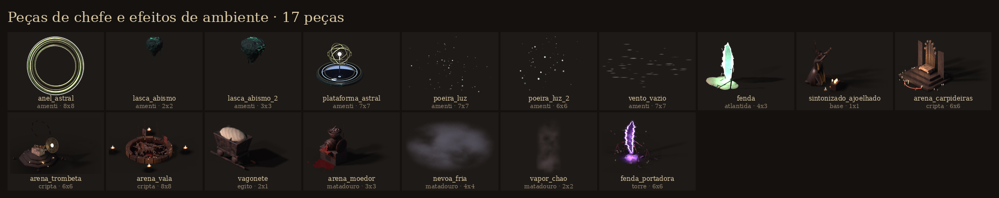

| id | bioma | tiles | o que é |
|---|---|---|---|
| `anel_astral` | amenti | 8x8 |  |
| `lasca_abismo` | amenti | 2x2 |  |
| `lasca_abismo_2` | amenti | 3x3 |  |
| `plataforma_astral` | amenti | 7x7 |  |
| `poeira_luz` | amenti | 7x7 |  |
| `poeira_luz_2` | amenti | 6x6 |  |
| `vento_vazio` | amenti | 7x7 |  |
| `fenda` | atlantida | 4x3 |  |
| `sintonizado_ajoelhado` | base | 1x1 | Cultista morto ajoelhado, rezando para a fenda: casaco de borracha, fones aparafusados no crânio, grade de alto-falante no lugar da boca, antenas de… |
| `arena_carpideiras` | cripta | 6x6 | Chefe 2 (Ossário): trono de ossos das Carpideiras com mar de velas. |
| `arena_trombeta` | cripta | 6x6 | Chefe 3: a Trombeta Calada, enorme trombeta de ferro e porcelana sobre altar, presa por correntes, com halo de ferro partido. |
| `arena_vala` | cripta | 8x8 | Chefe 1: a Vala da Grande Batalha, fosso de cadáveres no porão do abatedouro, covil do Andras, o General Partido. Montes de mortos, estandartes… |
| `vagonete` | egito | 2x1 | Vagonete basculante de ferro cheio de areia e lascas, nas rodinhas do trilho estreito. |
| `arena_moedor` | matadouro | 3x3 | O moedor de Benedito no fosso: moedor industrial de ferro fundido num pedestal de tijolo, funil cheio de restos, volante de manivela, boca de discos… |
| `nevoa_fria` | matadouro | 4x4 | Névoa fria rasteira da câmara fria (semitransparente): manchas azuladas de até meio metro que escorrem pelo chão. |
| `vapor_chao` | matadouro | 2x2 | Vapor subindo de um ralo ou caldeira (semitransparente), coluna quente que se desfaz a 2 m. |
| `fenda_portadora` | torre | 6x6 | O Topo da Repetidora: a fenda aberta pelo sinal, um rasgo vertical no ar feito de estática violeta e linhas de varredura, com bordas de papel… |

## Paredes, muros e limites do mapa

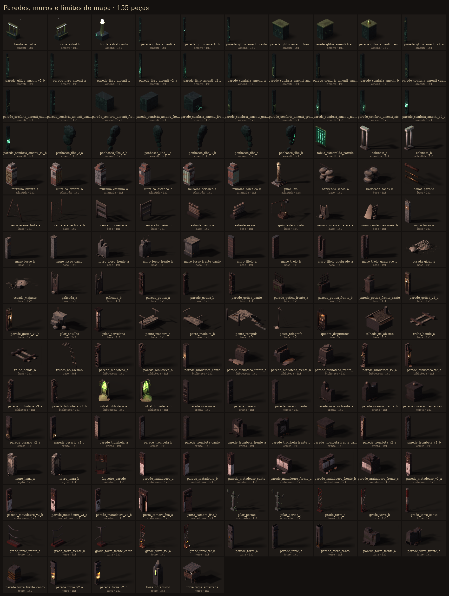

| id | bioma | tiles | o que é |
|---|---|---|---|
| `borda_astral_a` | amenti | 1x1 |  |
| `borda_astral_b` | amenti | 1x1 |  |
| `borda_astral_canto` | amenti | 1x1 |  |
| `parede_glifos_amenti_a` | amenti | 1x1 |  |
| `parede_glifos_amenti_b` | amenti | 1x1 |  |
| `parede_glifos_amenti_canto` | amenti | 1x1 |  |
| `parede_glifos_amenti_frente_a` | amenti | 1x1 |  |
| `parede_glifos_amenti_frente_b` | amenti | 1x1 |  |
| `parede_glifos_amenti_frente_canto` | amenti | 1x1 |  |
| `parede_glifos_amenti_v2_a` | amenti | 1x1 |  |
| `parede_glifos_amenti_v2_b` | amenti | 1x1 |  |
| `parede_livro_amenti_a` | amenti | 1x1 |  |
| `parede_livro_amenti_b` | amenti | 1x1 |  |
| `parede_livro_amenti_v2_a` | amenti | 1x1 |  |
| `parede_livro_amenti_v2_b` | amenti | 1x1 |  |
| `parede_sombria_amenti_a` | amenti | 1x1 |  |
| `parede_sombria_amenti_anubis_a` | amenti | 1x1 |  |
| `parede_sombria_amenti_anubis_b` | amenti | 1x1 |  |
| `parede_sombria_amenti_b` | amenti | 1x1 |  |
| `parede_sombria_amenti_caes_a` | amenti | 1x1 |  |
| `parede_sombria_amenti_caes_b` | amenti | 1x1 |  |
| `parede_sombria_amenti_canto` | amenti | 1x1 |  |
| `parede_sombria_amenti_frente_a` | amenti | 1x1 |  |
| `parede_sombria_amenti_frente_b` | amenti | 1x1 |  |
| `parede_sombria_amenti_frente_canto` | amenti | 1x1 |  |
| `parede_sombria_amenti_grade_a` | amenti | 1x1 |  |
| `parede_sombria_amenti_grade_b` | amenti | 1x1 |  |
| `parede_sombria_amenti_nicho_a` | amenti | 1x1 |  |
| `parede_sombria_amenti_nicho_b` | amenti | 1x1 |  |
| `parede_sombria_amenti_v2_a` | amenti | 1x1 |  |
| `parede_sombria_amenti_v2_b` | amenti | 1x1 |  |
| `penhasco_ilha_2_a` | amenti | 1x1 |  |
| `penhasco_ilha_2_b` | amenti | 1x1 |  |
| `penhasco_ilha_3_a` | amenti | 1x1 |  |
| `penhasco_ilha_3_b` | amenti | 1x1 |  |
| `penhasco_ilha_a` | amenti | 1x1 |  |
| `penhasco_ilha_b` | amenti | 1x1 |  |
| `tabua_esmeralda_parede` | amenti | 4x1 |  |
| `colunata_a` | atlantida | 2x1 |  |
| `colunata_b` | atlantida | 2x1 |  |
| `muralha_bronze_a` | atlantida | 1x1 |  |
| `muralha_bronze_b` | atlantida | 1x1 |  |
| `muralha_estanho_a` | atlantida | 1x1 |  |
| `muralha_estanho_b` | atlantida | 1x1 |  |
| `muralha_oricalco_a` | atlantida | 1x1 |  |
| `muralha_oricalco_b` | atlantida | 1x1 |  |
| `pilar_leis` | atlantida | 4x4 |  |
| `barricada_sacos_a` | base | 1x1 |  |
| `barricada_sacos_b` | base | 1x1 |  |
| `canos_parede` | base | 2x1 |  |
| `cerca_arame_torta_a` | base | 1x1 |  |
| `cerca_arame_torta_b` | base | 1x1 |  |
| `cerca_chiqueiro_a` | base | 1x1 |  |
| `cerca_chiqueiro_b` | base | 1x1 |  |
| `estante_ossos_a` | base | 1x1 | Nicho de ossos encostado na parede de trás do Ossário: tíbias empilhadas e crânios em fileira. |
| `estante_ossos_b` | base | 1x1 | Nicho de ossos encostado na parede de trás do Ossário: tíbias empilhadas e crânios em fileira. |
| `guindaste_sucata` | base | 4x4 | Guindaste de sucata na beira do precipício, com gancho e corrente. |
| `muro_contencao_areia_a` | base | 1x1 | Muro de contenção de tábuas e sacos segurando a duna (adro da capela). |
| `muro_contencao_areia_b` | base | 1x1 | Muro de contenção de tábuas e sacos segurando a duna (adro da capela). |
| `muro_fosso_a` | base | 1x1 | Muro do fosso (3 m, a mureta da arquibancada de baixo): concreto com faixa de propaganda desbotada, estacas e arame farpado no topo. |
| `muro_fosso_b` | base | 1x1 | Muro do fosso (3 m, a mureta da arquibancada de baixo): concreto com faixa de propaganda desbotada, estacas e arame farpado no topo. |
| `muro_fosso_canto` | base | 1x1 |  |
| `muro_fosso_frente_a` | base | 1x1 | Frente do fosso (lado da câmera): mureta quebrada na altura do joelho com estacas, para não tampar a luta. |
| `muro_fosso_frente_b` | base | 1x1 | Frente do fosso (lado da câmera): mureta quebrada na altura do joelho com estacas, para não tampar a luta. |
| `muro_fosso_frente_canto` | base | 1x1 |  |
| `muro_tijolo_a` | base | 1x1 |  |
| `muro_tijolo_b` | base | 1x1 |  |
| `muro_tijolo_quebrado_a` | base | 1x1 |  |
| `muro_tijolo_quebrado_b` | base | 1x1 |  |
| `ossada_gigante` | base | 6x4 | Ossada de criatura gigante meio enterrada (Mar de Dunas). |
| `ossada_viajante` | base | 2x2 | Ossada de quem tentou atravessar a tempestade: esqueleto, mochila e cantil. |
| `palicada_a` | base | 1x1 | Cerca do Acampamento da Vela: mourões, travessas, tábuas de alturas diferentes com fresta, chapa de zinco ondulada e arame farpado. Baixa (1,5 m)… |
| `palicada_b` | base | 1x1 | Cerca do Acampamento da Vela: mourões, travessas, tábuas de alturas diferentes com fresta, chapa de zinco ondulada e arame farpado. Baixa (1,5 m)… |
| `parede_gotica_a` | base | 1x1 | Parede gótica inglesa: tijolo escuro, embasamento, cordão e coroamento de cantaria, cunhal na emenda. |
| `parede_gotica_b` | base | 1x1 | Parede gótica inglesa: tijolo escuro, embasamento, cordão e coroamento de cantaria, cunhal na emenda. |
| `parede_gotica_canto` | base | 1x1 | Pilar de canto em cantaria, com pináculo baixo. |
| `parede_gotica_frente_a` | base | 1x1 | Meia-parede da frente: mureta de tijolo com capa de cantaria e grade de ferro batido com lanças (não tampa). |
| `parede_gotica_frente_b` | base | 1x1 | Meia-parede da frente: mureta de tijolo com capa de cantaria e grade de ferro batido com lanças (não tampa). |
| `parede_gotica_frente_canto` | base | 1x1 | Pilarete da frente com bola de pedra. |
| `parede_gotica_v2_a` | base | 1x1 | Arco Tudor cego em cantaria com lampião a gás aceso (a luz da sala vem daqui). |
| `parede_gotica_v2_b` | base | 1x1 | Arco Tudor cego em cantaria com lampião a gás aceso (a luz da sala vem daqui). |
| `pilar_entulho` | base | 2x2 | Pilar baixo de entulho (cobertura contra o Bote dos leões): blocos de concreto, ferragem e sacos. |
| `pilar_porcelana` | base | 2x2 |  |
| `ponte_madeira_a` | base | 1x1 | Segmento de ponte de tábuas sobre estacas (encaixe lado a lado ao longo do eixo). |
| `ponte_madeira_b` | base | 1x1 | Segmento de ponte de tábuas sobre estacas (encaixe lado a lado ao longo do eixo). |
| `ponte_rompida` | base | 3x6 | Ponte de tábuas rompida pendendo no abismo. |
| `poste_telegrafo` | base | 1x1 | Poste de telégrafo de madeira inclinado, com isoladores e fios caídos. |
| `quadro_disjuntores` | base | 2x1 | Quadro de força de parede: painel de ardósia com chaves-faca de cobre sobre porcelana, fusíveis, amperímetros, barramento e cabos subindo e descendo.… |
| `telhado_no_abismo` | base | 5x5 | Telhado de casa da Cidade Velha visto lá embaixo no abismo (cenário da moldura). |
| `trilho_bonde_a` | base | 1x1 | Trilhos do bonde da linha 7 (segmento de 1 tile, enterrado na cinza). |
| `trilho_bonde_b` | base | 1x1 | Trilhos do bonde da linha 7 (segmento de 1 tile, enterrado na cinza). |
| `trilhos_no_abismo` | base | 3x4 | Fim da Linha 7: trilhos e dormentes pendurados sobre o precipício. |
| `parede_biblioteca_a` | biblioteca | 1x1 | Parede de trás da sala de leitura: estante de imbuia embutida do chão à galeria, cheia de lombadas de couro e pano com filetes de ouro e etiquetas de… |
| `parede_biblioteca_b` | biblioteca | 1x1 | Parede de trás da sala de leitura: estante de imbuia embutida do chão à galeria, cheia de lombadas de couro e pano com filetes de ouro e etiquetas de… |
| `parede_biblioteca_canto` | biblioteca | 1x1 | Pilastra de canto: cantaria com base e capitel moldurados na altura da galeria e um castiçal de ferro com três velas, cera escorrida até o chão. |
| `parede_biblioteca_frente_a` | biblioteca | 1x1 | Meia-parede da frente (~0,7 m): toco de cantaria quebrado e o pé da estante partida, com livros escorrendo para dentro da sala; nunca tapa o… |
| `parede_biblioteca_frente_b` | biblioteca | 1x1 | Meia-parede da frente (~0,7 m): toco de cantaria quebrado e o pé da estante partida, com livros escorrendo para dentro da sala; nunca tapa o… |
| `parede_biblioteca_frente_canto` | biblioteca | 1x1 | Toco da pilastra da frente: base moldurada inteira e o fuste quebrado, com lascas no chão. |
| `parede_biblioteca_v2_a` | biblioteca | 1x1 | Variante: estante saqueada pela areia, com vãos e livros tombados, areia escorrendo da galeria em filete e assentada nas tábuas; uma arandela de… |
| `parede_biblioteca_v2_b` | biblioteca | 1x1 | Variante: estante saqueada pela areia, com vãos e livros tombados, areia escorrendo da galeria em filete e assentada nas tábuas; uma arandela de… |
| `parede_biblioteca_v3_a` | biblioteca | 1x1 | Variante: trilho de latão com a escada de correr de imbuia encostada nas lombadas, etiquetas de classificação nas tábuas e um livro aberto esquecido… |
| `parede_biblioteca_v3_b` | biblioteca | 1x1 | Variante: trilho de latão com a escada de correr de imbuia encostada nas lombadas, etiquetas de classificação nas tábuas e um livro aberto esquecido… |
| `vitral_biblioteca_a` | biblioteca | 3x1 | O vitral da sala de leitura, que hoje fica na altura da rua: ogiva de cantaria com mainéis de ferro e cacos de vidro verde e âmbar acesos pelo Amargo… |
| `vitral_biblioteca_b` | biblioteca | 3x1 | O vitral da sala de leitura, que hoje fica na altura da rua: ogiva de cantaria com mainéis de ferro e cacos de vidro verde e âmbar acesos pelo Amargo… |
| `parede_ossario_a` | cripta | 1x1 | Ossário das Carpideiras: nichos com crânios e ossos empilhados. |
| `parede_ossario_b` | cripta | 1x1 | Ossário das Carpideiras: nichos com crânios e ossos empilhados. |
| `parede_ossario_canto` | cripta | 1x1 | Pilar de canto do Ossário, com coluna de crânios. |
| `parede_ossario_frente_a` | cripta | 1x1 | Meia-parede da frente do Ossário: pedra rachada com crânios assentados no topo. |
| `parede_ossario_frente_b` | cripta | 1x1 | Meia-parede da frente do Ossário: pedra rachada com crânios assentados no topo. |
| `parede_ossario_frente_canto` | cripta | 1x1 |  |
| `parede_ossario_v2_a` | cripta | 1x1 | Ossário: arco de nicho com uma carpideira de ossos sentada, coberta de pano e cera de vela. |
| `parede_ossario_v2_b` | cripta | 1x1 | Ossário: arco de nicho com uma carpideira de ossos sentada, coberta de pano e cera de vela. |
| `parede_trombeta_a` | cripta | 1x1 | Câmara da Trombeta: pedra clara com placas de porcelana rachada e nervuras de ferro. |
| `parede_trombeta_b` | cripta | 1x1 | Câmara da Trombeta: pedra clara com placas de porcelana rachada e nervuras de ferro. |
| `parede_trombeta_canto` | cripta | 1x1 | Pilar de canto da Câmara, com cinta de latão. |
| `parede_trombeta_frente_a` | cripta | 1x1 | Meia-parede da frente da Câmara: pedra clara, caco de porcelana e toco de nervura de ferro. |
| `parede_trombeta_frente_b` | cripta | 1x1 | Meia-parede da frente da Câmara: pedra clara, caco de porcelana e toco de nervura de ferro. |
| `parede_trombeta_frente_canto` | cripta | 1x1 |  |
| `parede_trombeta_v2_a` | cripta | 1x1 | Câmara: placa de porcelana com a trombeta em relevo de latão e tubo de órgão subindo pela parede. |
| `parede_trombeta_v2_b` | cripta | 1x1 | Câmara: placa de porcelana com a trombeta em relevo de latão e tubo de órgão subindo pela parede. |
| `muro_lama_a` | egito | 1x1 | Muro de tijolo de lama do Nilo (cercas da cidade e dos templos): fiadas em onda, reboco de lama em manchas, capeamento arredondado, pé roído pela… |
| `muro_lama_b` | egito | 1x1 | Muro de tijolo de lama do Nilo (cercas da cidade e dos templos): fiadas em onda, reboco de lama em manchas, capeamento arredondado, pé roído pela… |
| `faqueiro_parede` | matadouro | 1x1 | Quadro de ferramentas do magarefe em pé: tábua grossa num cavalete de ferro com facas, cutelos, serrote e chaira pendurados, um amolador de couro e o… |
| `parede_matadouro_a` | matadouro | 1x1 | Parede de trás do Porão: azulejo branco rachado e encardido de sangue até meia altura, faixa cor de boi, tijolo de fuligem acima, viga I rebitada e… |
| `parede_matadouro_b` | matadouro | 1x1 | Parede de trás do Porão: azulejo branco rachado e encardido de sangue até meia altura, faixa cor de boi, tijolo de fuligem acima, viga I rebitada e… |
| `parede_matadouro_canto` | matadouro | 1x1 | Pilar de canto do Porão: tijolo com azulejo nas faces, cantoneiras rebitadas e capitel de ferro. |
| `parede_matadouro_frente_a` | matadouro | 1x1 | Meia-parede da frente (~0,6 m): tijolo quebrado, azulejo rachado na face, cano rompido e entulho; nunca tapa o personagem. |
| `parede_matadouro_frente_b` | matadouro | 1x1 | Meia-parede da frente (~0,6 m): tijolo quebrado, azulejo rachado na face, cano rompido e entulho; nunca tapa o personagem. |
| `parede_matadouro_frente_canto` | matadouro | 1x1 | Toco de pilar na quina da frente: tijolo quebrado com resto de azulejo e cantoneira torta. |
| `parede_matadouro_v2_a` | matadouro | 1x1 | Variante: azulejo arrancado em mancha, mão de sangue arrastada, válvula, manômetro e gancho na parede. |
| `parede_matadouro_v2_b` | matadouro | 1x1 | Variante: azulejo arrancado em mancha, mão de sangue arrastada, válvula, manômetro e gancho na parede. |
| `parede_matadouro_v3_a` | matadouro | 1x1 | Variante: pilastra de chapa rebitada, quadro de ferramentas de desossa (facas, cutelo, serrote) e pano sujo. |
| `parede_matadouro_v3_b` | matadouro | 1x1 | Variante: pilastra de chapa rebitada, quadro de ferramentas de desossa (facas, cutelo, serrote) e pano sujo. |
| `porta_camara_fria_a` | matadouro | 1x1 | Porta de câmara fria na parede de trás: folha grossa forrada de zinco, dobradiças de ferro, trinco de alavanca, geada nas bordas e marcas de unha por… |
| `porta_camara_fria_b` | matadouro | 1x1 | Porta de câmara fria na parede de trás: folha grossa forrada de zinco, dobradiças de ferro, trinco de alavanca, geada nas bordas e marcas de unha por… |
| `pilar_portao` | novo_eden | 1x1 |  |
| `pilar_portao_2` | novo_eden | 1x1 |  |
| `grade_torre_a` | torre | 1x1 | Lado de trás da plataforma aberta: treliça do mastro em aço vermelho e branco descascado, contraventamento em X, chapas rebitadas, cabos coaxiais e… |
| `grade_torre_b` | torre | 1x1 | Lado de trás da plataforma aberta: treliça do mastro em aço vermelho e branco descascado, contraventamento em X, chapas rebitadas, cabos coaxiais e… |
| `grade_torre_canto` | torre | 1x1 | Montante da treliça no canto: perna de cantoneira pesada com emenda aparafusada e grampos de subida. |
| `grade_torre_frente_a` | torre | 1x1 | Guarda-corpo baixo da frente da plataforma, amassado, sobre a viga de borda vermelha. |
| `grade_torre_frente_b` | torre | 1x1 | Guarda-corpo baixo da frente da plataforma, amassado, sobre a viga de borda vermelha. |
| `grade_torre_frente_canto` | torre | 1x1 | Poste do guarda-corpo na quina da frente, corrimãos tortos chegando dos dois lados. |
| `grade_torre_v2_a` | torre | 1x1 | Treliça com isolador de porcelana, chapa com a marca da Congregação amarrada com arame e fitas de pano, velas no rodapé. |
| `grade_torre_v2_b` | torre | 1x1 | Treliça com isolador de porcelana, chapa com a marca da Congregação amarrada com arame e fitas de pano, velas no rodapé. |
| `parede_torre_a` | torre | 1x1 | Parede interna da Repetidora: concreto de forma manchado, faixa verde institucional descascando, calha de cabos, eletrodutos e placa de ALTA TENSÃO. |
| `parede_torre_b` | torre | 1x1 | Parede interna da Repetidora: concreto de forma manchado, faixa verde institucional descascando, calha de cabos, eletrodutos e placa de ALTA TENSÃO. |
| `parede_torre_canto` | torre | 1x1 | Pilar de canto de concreto: faixa verde, prumada de cabos e faixas zebradas de perigo na base. |
| `parede_torre_frente_a` | torre | 1x1 | Meia-parede da frente: concreto quebrado na altura do joelho, ferragem retorcida e eletroduto rompido. |
| `parede_torre_frente_b` | torre | 1x1 | Meia-parede da frente: concreto quebrado na altura do joelho, ferragem retorcida e eletroduto rompido. |
| `parede_torre_frente_canto` | torre | 1x1 | Toco de pilar na quina da frente, com zebrado de perigo e ferragem aparente. |
| `parede_torre_v2_a` | torre | 1x1 | Parede da Repetidora tomada pela Congregação: marca da trombeta e da onda em tinta de válvula, prateleira de velas, folhas de escuta pregadas e o… |
| `parede_torre_v2_b` | torre | 1x1 | Parede da Repetidora tomada pela Congregação: marca da trombeta e da onda em tinta de válvula, prateleira de velas, folhas de escuta pregadas e o… |
| `torre_no_abismo` | torre | 3x3 | Torre de igreja da Cidade Velha emergindo do abismo (cenário da moldura). |
| `torre_vigia_enterrada` | torre | 4x4 | Torre de vigia da Linha do Impasse engolida pela tempestade. |

## Prédios e estruturas grandes

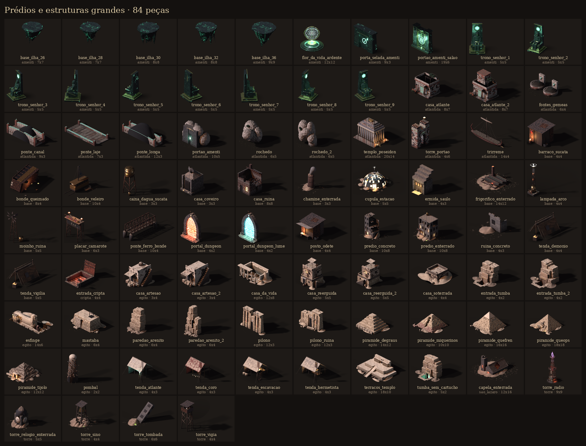

| id | bioma | tiles | o que é |
|---|---|---|---|
| `base_ilha_26` | amenti | 7x7 |  |
| `base_ilha_28` | amenti | 7x7 |  |
| `base_ilha_30` | amenti | 8x8 |  |
| `base_ilha_32` | amenti | 8x8 |  |
| `base_ilha_36` | amenti | 9x9 |  |
| `flor_da_vida_ardente` | amenti | 12x12 |  |
| `porta_selada_amenti` | amenti | 9x3 |  |
| `portao_amenti_salao` | amenti | 19x6 |  |
| `trono_senhor_1` | amenti | 5x5 | (girada 315.0 graus) |
| `trono_senhor_2` | amenti | 5x5 | (girada 283.75 graus) |
| `trono_senhor_3` | amenti | 5x5 | (girada 252.5 graus) |
| `trono_senhor_4` | amenti | 5x5 | (girada 221.25 graus) |
| `trono_senhor_5` | amenti | 5x5 | (girada 190.0 graus) |
| `trono_senhor_6` | amenti | 5x5 | (girada 80.0 graus) |
| `trono_senhor_7` | amenti | 5x5 | (girada 48.75 graus) |
| `trono_senhor_8` | amenti | 5x5 | (girada 17.5 graus) |
| `trono_senhor_9` | amenti | 5x5 | (girada 346.25 graus) |
| `casa_atlante` | atlantida | 8x7 |  |
| `casa_atlante_2` | atlantida | 8x7 |  |
| `fontes_gemeas` | atlantida | 6x4 |  |
| `ponte_canal` | atlantida | 9x3 |  |
| `ponte_laje` | atlantida | 7x3 |  |
| `ponte_longa` | atlantida | 12x3 |  |
| `portao_amenti` | atlantida | 10x5 |  |
| `rochedo` | atlantida | 6x5 |  |
| `rochedo_2` | atlantida | 6x5 |  |
| `templo_poseidon` | atlantida | 20x14 |  |
| `torre_portao` | atlantida | 4x6 |  |
| `trirreme` | atlantida | 14x4 |  |
| `barraco_sucata` | base | 4x4 | Barraco de sucata: chapas de zinco, portas velhas, placa de trânsito. |
| `bonde_queimado` | base | 8x4 | Bonde da linha 7 tombado e queimado nos Campos de Cinza. |
| `bonde_veleiro` | base | 10x4 | Bonde da linha 7 adaptado como bonde-veleiro: mastro, vela de lona remendada, rodas sobre os trilhos que aparecem na areia. |
| `caixa_dagua_sucata` | base | 3x3 | Caixa d'água de sobreviventes: tanque de latão sobre estrutura de vigas, com filtro. |
| `casa_coveiro` | base | 3x3 | Pequeno mausoléu de família com porta de ferro e anjo de pedra sem cabeça. |
| `casa_ruina` | base | 8x8 | Sobrado de tijolo com reboco caído, segundo andar desabado, janela acesa. |
| `chamine_enterrada` | base | 3x3 | Chaminé de fábrica saindo da areia, com fumaça e escada de ferro. |
| `cupula_estacao` | base | 5x5 | Cúpula de vidro da estação de bonde, coração do Acampamento da Vela: costelas de ferro, vidraças acesas por dentro (velas da Vigília), remendos de… |
| `ermida_saulo` | base | 4x3 | Ermida do Saulo: nicho baixo de concreto debaixo da arquibancada, velas derretidas, esteira de palha, a Couraça do Agrak pendurada em ganchos e as… |
| `frigorifico_enterrado` | base | 14x12 | Abatedouro Carniça (frigorífico) enterrado até o segundo andar; entra-se pelas claraboias do telhado em serra. |
| `lampada_arco` | base | 4x4 | Lâmpada de arco do Acampamento da Vela: mastro de ferro e latão com bobinas de tesla e um arco elétrico azul que afasta os mortos. |
| `moinho_ruina` | base | 5x5 | Moinho de vento de ferro parado, com pás rasgadas. |
| `placar_camarote` | base | 6x3 | Placar enferrujado do estádio com o camarote de Caim e Abel em cima: SÃO LÁZARO 0 x 0, megafone, braseiros. |
| `ponte_ferro_bonde` | base | 10x4 | Ponte de ferro treliçada da Linha 7 sobre o leito seco do rio. |
| `portal_dungeon` | base | 4x2 | Portal de dungeon, véu rubro (Cripta da Trombeta Calada, A Torre). |
| `portal_dungeon_lume` | base | 4x2 | Portal de dungeon, véu ciano (Catacumba das Raízes, no Novo Éden). |
| `posto_odete` | base | 4x4 | Posto da Odete: barraca de sucata e lona junto ao bonde tombado, com balcão e lanterna. |
| `predio_concreto` | base | 10x8 | Bloco de apartamentos de concreto partido, meio enterrado na areia; sobreviventes vivem no térreo com remendos de sucata e uma janela acesa. |
| `predio_enterrado` | base | 10x8 | Prédio de São Lázaro enterrado até o quarto andar: os moradores vivem nos andares de cima e entram pelas janelas por pranchas e escadas de corda. |
| `ruina_concreto` | base | 4x3 | Canto de parede de concreto com janela e vergalhões, meio soterrado. |
| `tenda_demonio` | base | 4x4 | Tenda dos demônios: couro negro esticado em ossos, com brasa e correntes. |
| `tenda_vigilia` | base | 5x5 | Tenda de lona remendada do Acampamento da Vela. |
| `entrada_cripta` | cripta | 4x4 | Entrada do porão do Abatedouro que leva à Cripta da Trombeta Calada: alçapão de ferro arrombado, escada descendo, luz vermelha lá dentro. |
| `casa_artesao` | egito | 3x4 | Casa da Vila dos Artesãos (Deir el-Medina): estreita, de tijolo caiado sujo sobre embasamento de pedra, porta com o batente pintado de vermelho,… |
| `casa_artesao_2` | egito | 3x4 | Casa da Vila dos Artesãos (variante) com o teto de vigas de palmeira meio desabado. |
| `casa_da_vida` | egito | 12x8 | A Casa da Vida, biblioteca do templo, meio enterrada: pórtico de colunas papiriformes de botão fechado, o teto caído deixando ver por dentro as… |
| `casa_reerguida` | egito | 5x5 | Casa de Mênfis Reerguida: o térreo é de pedra de três mil anos, meio desenterrado (porta com o disco alado no lintel); em cima, o andar novo de… |
| `casa_reerguida_2` | egito | 5x5 | Casa de Mênfis Reerguida (variante): escada de tijolo na frente até o terraço baixo e outra lateral até o alto. |
| `casa_soterrada` | egito | 4x4 | Casa ainda soterrada: só o terraço, o parapeito e a parte de cima das paredes saem da duna de areia clara; uma janela no nível da areia e a escada de… |
| `entrada_tumba` | egito | 4x2 | Entrada de tumba do Vale dos Reis: escada cavada descendo até a porta retangular aberta no paredão de calcário, batentes alisados, lintel com o disco… |
| `entrada_tumba_2` | egito | 4x2 | Entrada de tumba do Vale dos Reis já registrada pela escavação: grade de ferro com cadeado, tábuas de escora, o número da tumba pintado em ocre e… |
| `esfinge` | egito | 14x6 | A Grande Esfinge de Gizé, desenterrada pela cheia: cabeça com o nemes listrado (restos de pintura) e o nariz quebrado, corpo de leão roído em… |
| `mastaba` | egito | 6x4 | Mastaba de Sacará: banco de calcário em talude sobre o poço funerário, com a falsa-porta de nichos na face leste, a mesa de oferendas (hotep) na… |
| `paredao_arenito` | egito | 6x4 | Paredão de calcário e arenito do Vale dos Reis (borda alta): camadas roídas, saliências, tálus de lascas. |
| `paredao_arenito_2` | egito | 6x4 | Paredão do Vale dos Reis, variante com um contraforte destacado e uma fenda escura (borda alta). |
| `pilono` | egito | 12x3 | Pilono de Ipet-Isut (Karnak): duas torres em talude com toro e cornija de cavetto, o portal com o disco solar alado, os nichos com os mastros de… |
| `pilono_ruina` | egito | 12x3 | Pilono em ruína: a torre da esquerda desabou pela metade, o lintel do portal caiu, entulho e areia na base. |
| `piramide_degraus` | egito | 14x12 | A pirâmide de degraus de Djoser em Sacará (Imhotep): seis mastabas empilhadas em talude, de calcário miúdo, roídas pelo vento, com o entulho… |
| `piramide_miquerinos` | egito | 10x10 | A pirâmide de Miquerinos: a menor das três, com as fiadas de baixo ainda revestidas de granito rosa de Assuã (nunca alisado) e o grande rasgo… |
| `piramide_quefren` | egito | 16x16 | A pirâmide de Quéfren: mais íngreme, em degrau embaixo e com o revestimento liso de calcário de Tura ainda no topo (a única que guardou a pele), com… |
| `piramide_queops` | egito | 18x18 | A Grande Pirâmide de Quéops em escala de jogo: fiadas em degrau (o revestimento de Tura foi roubado), blocos gastos e quinas roídas; na face da… |
| `piramide_tijolo` | egito | 12x12 | A pirâmide de tijolo de Amenemés III em Hawara: tijolo de lama erodido num monte, restos do revestimento de calcário na base e, na face da frente, a… |
| `pombal` | egito | 2x2 | Pombal do Nilo: torre de tijolo de lama em tronco de cone caiada em faixas, cravejada de potes de barro deitados (as casas das pombas) e de varas de… |
| `tenda_atlante` | egito | 4x3 | Tenda da Embaixada de Thotme (atlantes de Diaprepes): lona branca com debrum de oricalco, varas de bronze, uma ânfora com o selo do rei, o… |
| `tenda_coro` | egito | 4x3 | Tenda do Coro (Cônego Barnabé): lona vinho remendada, estandarte com a trombeta de ouro, genuflexório, velas e a balança de bronze que querem usar no… |
| `tenda_escavacao` | egito | 4x3 | Tenda do capataz Reis Abdu: lona de linho cru, mesa com o livro de ponto e a lamparina, caixotes de achados, pás, picaretas e cestos; a bandeira… |
| `tenda_hermetista` | egito | 4x3 | Tenda da Casa de Hermes (o mago Djedi): lona cor de linho sujo, estandarte com o caduceu de Hermes, mesa com astrolábio, rolos e a balança, o tapete… |
| `terracos_templo` | egito | 18x10 | O templo de Hatshepsut em Deir el-Bahari: três terraços de calcário com colunatas de pilares quadrados, a rampa central subindo pelo meio, os pilares… |
| `tumba_sem_cartucho` | egito | 5x2 | A tumba sem cartucho (porta da Raid 'O Coração Endurecido'): porta selada com o reboco e o selo da necrópole (o chacal sobre os nove cativos)… |
| `capela_enterrada` | sao_lazaro | 12x16 | Capela de São Lázaro enterrada até o coro: a rosácea vira a entrada e a nave brilha verde lá dentro. |
| `torre_radio` | torre | 9x9 | A Repetidora do Granizo: mastro de rádio de treliça vermelho e branco (23 m) sobre o prédio dos transmissores, com o portão de carga aceso pelo véu… |
| `torre_relogio_enterrada` | torre | 5x5 | Torre do relógio de São Lázaro enterrada: só o mostrador e o telhado saem da areia. |
| `torre_sino` | torre | 4x4 | Campanário de madeira e ferro com o sino rachado (Rua do Sino). |
| `torre_tombada` | torre | 6x6 | Resto de torre de concreto tombada e cravada na areia, em ângulo. |
| `torre_vigia` | torre | 4x4 | Torre de vigia de madeira e sucata com holofote. |

## Colunas, arcos, degraus e peças de arquitetura

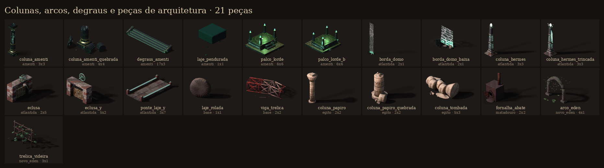

| id | bioma | tiles | o que é |
|---|---|---|---|
| `coluna_amenti` | amenti | 3x3 |  |
| `coluna_amenti_quebrada` | amenti | 4x4 |  |
| `degraus_amenti` | amenti | 17x3 |  |
| `laje_pendurada` | amenti | 1x1 |  |
| `palco_lorde` | amenti | 6x6 |  |
| `palco_lorde_b` | amenti | 6x6 |  |
| `borda_domo` | atlantida | 2x1 |  |
| `borda_domo_baixa` | atlantida | 2x1 |  |
| `coluna_hermes` | atlantida | 3x3 |  |
| `coluna_hermes_trincada` | atlantida | 3x3 |  |
| `eclusa` | atlantida | 2x5 |  |
| `eclusa_y` | atlantida | 5x2 | (girada: ao longo do eixo Y do mapa) |
| `ponte_laje_y` | atlantida | 3x7 | (girada: ao longo do eixo Y do mapa) |
| `laje_rolada` | base | 1x1 | Laje redonda da entrada do sepulcro, rolada para o lado e encostada inclinada numa pedra. |
| `viga_trelica` | base | 2x2 | Pedaço de treliça vermelha e branca caído na plataforma: um trecho reto e outro entortado na queda, barras arrancadas com pontas rasgadas, parafusos… |
| `coluna_papiro` | egito | 2x2 | Coluna do salão hipostilo de Karnak: fuste papiriforme coberto de hieróglifos com restos de azul, amarrações pintadas e o capitel de papiro aberto… |
| `coluna_papiro_quebrada` | egito | 2x2 | Coluna papiriforme partida a meia altura, com os tambores e o capitel caídos ao lado. |
| `coluna_tombada` | egito | 5x3 | Coluna tombada: os tambores rolaram um a um pela areia e o capitel de papiro ficou de lado, com o ábaco. |
| `fornalha_abate` | matadouro | 2x2 | Fornalha de queimar osso e carcaça: forno de tijolo com arco, boca de ferro aberta em fogo laranja, cinza de osso transbordando, atiçador e chaminé… |
| `arco_eden` | novo_eden | 4x1 |  |
| `trelica_videira` | novo_eden | 3x1 |  |

## Portas, escadas, elevadores e passagens

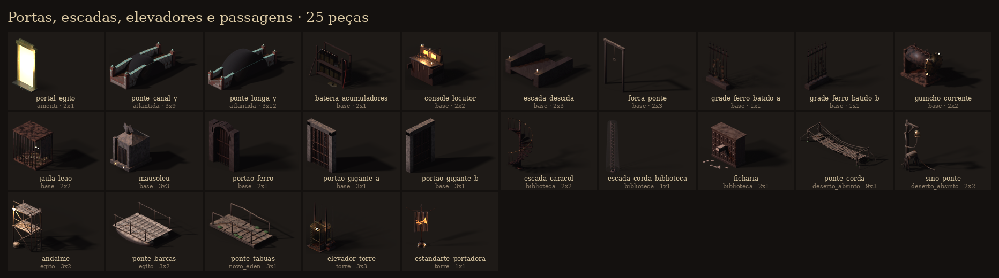

| id | bioma | tiles | o que é |
|---|---|---|---|
| `portal_egito` | amenti | 2x1 |  |
| `ponte_canal_y` | atlantida | 3x9 | (girada: ao longo do eixo Y do mapa) |
| `ponte_longa_y` | atlantida | 3x12 | (girada: ao longo do eixo Y do mapa) |
| `bateria_acumuladores` | base | 2x1 | Estante de acumuladores de vidro: placas de chumbo à vista, ácido turvo, pontes de cobre com crosta de sulfato e uma célula quebrada. |
| `console_locutor` | base | 2x2 | Mesa de som do locutor: tampo inclinado de botões de baquelite e faders, ponte com dois VU acesos em laranja, microfone de braço, fones e velas… |
| `escada_descida` | base | 2x3 |  |
| `forca_ponte` | base | 2x3 |  |
| `grade_ferro_batido_a` | base | 1x1 | Grade vitoriana de ferro batido (cerca túmulos), lanças e volutas, com hera seca. |
| `grade_ferro_batido_b` | base | 1x1 | Grade vitoriana de ferro batido (cerca túmulos), lanças e volutas, com hera seca. |
| `guincho_corrente` | base | 2x2 | Guincho do Portão do Gigante: tambor de corrente, engrenagens, manivela e trava. |
| `jaula_leao` | base | 2x2 | Jaula de sucata do Portão dos Leões: chapas e barras soldadas, palha e ossos no chão. |
| `mausoleu` | base | 3x3 | Pequeno mausoléu de família com porta de ferro e anjo de pedra sem cabeça. |
| `portao_ferro` | base | 2x1 |  |
| `portao_gigante_a` | base | 3x1 | Portão do Gigante (leste): o maior, grade baixada, duas correntes grossas penduradas na verga. |
| `portao_gigante_b` | base | 3x1 | Portão do Gigante (leste): o maior, grade baixada, duas correntes grossas penduradas na verga. |
| `escada_caracol` | biblioteca | 2x2 | Escada caracol de ferro fundido que sobe à galeria: mastro, degraus vazados, balaústres e corrimão de latão em espiral; some no escuro de cima. |
| `escada_corda_biblioteca` | biblioteca | 1x1 | Escada de corda que desce do óculo da cúpula até o assoalho (é por ela que se entra e se sai), com rolo de corda sobrando no chão e o feixe de luz de… |
| `ficharia` | biblioteca | 2x1 | Fichário de empréstimos: gaveteiro de carvalho com 24 gavetinhas de puxador e porta-etiqueta de latão, uma gaveta puxada cheia de fichas e fichas… |
| `ponte_corda` | deserto_absinto | 9x3 | Ponte de corda da Ilha do Exilado: tábuas gastas e desencontradas (de bonde, caixote e banco de igreja) sobre dois cabos de cânhamo, corrimãos de… |
| `sino_ponte` | deserto_absinto | 2x2 | Sino de chamar a ponte: forca de troncos com um sino de bronze rachado (de capela afogada), a corda de puxar amarrada no poste e, no pé, o sarilho de… |
| `andaime` | egito | 3x2 | Andaime de varas amarradas da escavação, dois níveis de tábuas, escada e lampião pendurado. |
| `ponte_barcas` | egito | 3x2 | Segmento da Ponte de Barcas dos Engenheiros: dois barcos amarrados lado a lado com o tabuleiro de tábuas por cima, guarda-corpo de corda e cabos de… |
| `ponte_tabuas` | novo_eden | 3x1 |  |
| `elevador_torre` | torre | 3x3 | Gaiola de carga de ferro com porta pantográfica aberta, trilhos-guia e cabos subindo para o escuro, guincho com motor e polia ao lado e lâmpada de… |
| `estandarte_portadora` | torre | 1x1 | Estandarte da Congregação da Portadora: lona suja pendurada numa travessa de antena, com a marca (onda senoidal atravessando uma trombeta) em tinta… |

## Decalques de chão (manchas, rastros, símbolos)

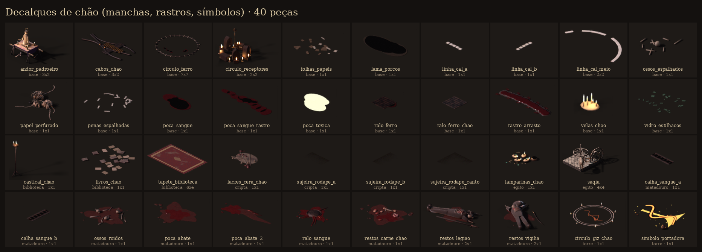

| id | bioma | tiles | o que é |
|---|---|---|---|
| `andor_padroeiro` | base | 3x2 | Andor de São Lázaro pousado no chão no meio da Procissão Parada: varais ao longo de X, pano roxo, imagem do padroeiro com faixas de linho nos pulsos… |
| `cabos_chao` | base | 3x2 | Cabos grossos de borracha serpenteando pelo chão, com emendas de latão e fita isolante. |
| `circulo_ferro` | base | 7x7 | Círculo de Ferro: anel de trilho de bonde cravado na areia (raio 3,5 tiles), dormentes e grampos. |
| `circulo_receptores` | base | 2x2 | Santuário da Congregação: rádios velhos em círculo virados para dentro, com as válvulas laranja acesas, velas entre eles e um microfone de pedestal… |
| `folhas_papeis` | base | 1x1 |  |
| `lama_porcos` | base | 1x1 |  |
| `linha_cal_a` | base | 1x1 | Linha de cal do antigo campo, apagada aos pedaços (1 tile). |
| `linha_cal_b` | base | 1x1 | Linha de cal do antigo campo, apagada aos pedaços (1 tile). |
| `linha_cal_meio` | base | 2x2 | Pedaço do círculo central do campo em cal. |
| `ossos_espalhados` | base | 1x1 |  |
| `papel_perfurado` | base | 1x1 | Montes de fita de papel perfurado no chão da Central de Escuta: rolos inteiros desenrolados em laçadas, fitas soltas atravessando o piso e dois… |
| `penas_espalhadas` | base | 1x1 |  |
| `poca_sangue` | base | 1x1 |  |
| `poca_sangue_rastro` | base | 1x1 |  |
| `poca_toxica` | base | 1x1 |  |
| `ralo_ferro` | base | 1x1 |  |
| `ralo_ferro_chao` | base | 1x1 |  |
| `rastro_arrasto` | base | 1x1 | Rastro de arrasto: sulco largo de sangue velho e unhas na poeira, de alguém que se puxa pelos braços. |
| `velas_chao` | base | 1x1 | Velas de sebo coladas no chão em cera escorrida, de alturas diferentes. |
| `vidro_estilhacos` | base | 1x1 |  |
| `castical_chao` | biblioteca | 1x1 | Castiçal de chão de ferro, de três pés, com três velas acesas e cera escorrida até a base. |
| `livros_chao` | biblioteca | 1x1 | Decalque: livros caídos, páginas soltas e fichas espalhadas no assoalho. |
| `tapete_biblioteca` | biblioteca | 6x4 | Decalque: tapete persa vermelho-sangue puído, com a trama à mostra no meio e areia nas franjas. |
| `lacres_cera_chao` | cripta | 1x1 | Decalque de chão: lacres de cera vermelha arrancados do peito dos Não-Julgados, tocos de vela, cera derramada e fitas com o selo, onde um deles se… |
| `sujeira_rodape_a` | cripta | 1x1 | Sujeira de rodapé no pé da parede de trás da cripta (chao=1). |
| `sujeira_rodape_b` | cripta | 1x1 | Sujeira de rodapé no pé da parede de trás da cripta (chao=1). |
| `sujeira_rodape_canto` | cripta | 1x1 | Sujeira de rodapé no pé da parede de trás da cripta (chao=1). |
| `lamparinas_chao` | egito | 1x1 | Lamparinas de barro acesas no chão diante de um nicho (o fogo dos que ainda rezam aqui), uma tigela de óleo, pavios de linho e amuletos ankh e olho… |
| `saqia` | egito | 4x4 | Saqia: a roda d'água de alcatruzes movida por um boi que anda em círculo; a engrenagem horizontal de madeira gira a roda vertical cheia de potes de… |
| `calha_sangue_a` | matadouro | 1x1 | Calha de sangue no chão (decalque): canaleta de concreto com grelha de ferro e sangue escorrendo. |
| `calha_sangue_b` | matadouro | 1x1 | Calha de sangue no chão (decalque): canaleta de concreto com grelha de ferro e sangue escorrendo. |
| `ossos_roidos` | matadouro | 1x1 | Ossos roídos espalhados no chão da Vala (decalque): costelas, fêmures partidos, dentes, um maxilar. |
| `poca_abate` | matadouro | 1x1 | Poça de sangue do matadouro (decalque): parte fresca e brilhante no meio, borda velha e escura, respingos. |
| `poca_abate_2` | matadouro | 1x1 | Rastro de sangue arrastado (decalque): faixa larga que afina, com marcas de dedos. |
| `ralo_sangue` | matadouro | 1x1 | Ralo redondo de ferro onde o sangue do chão converge, com riscos de sangue chegando de todo lado. |
| `restos_carne_chao` | matadouro | 1x1 | Decalque de chão: aparas de carne, nacos de gordura, um osso de joelho e sangue pisado com marcas de bota. |
| `restos_legiao` | matadouro | 2x1 | Restos espalhados no chão da Vala: um soldado da Legião meio comido, capacete com chifres e pique quebrado. |
| `restos_vigilia` | matadouro | 2x1 | Restos de um soldado da Vigília no chão da Vala: sobretudo de lona, chapéu de aba larga, sabre. |
| `circulo_giz_chao` | torre | 1x1 | Decalque de chão: círculo de escuta riscado a giz e tinta de válvula, a onda senoidal atravessando a trombeta no meio, os números da contagem… |
| `simbolo_portadora` | torre | 1x1 | A marca da Congregação pintada no chão em tinta de válvula laranja que brilha fraco: onda senoidal atravessando uma trombeta, com respingos, a lata… |

## Vegetação (árvores, arbustos, raízes, fungos)

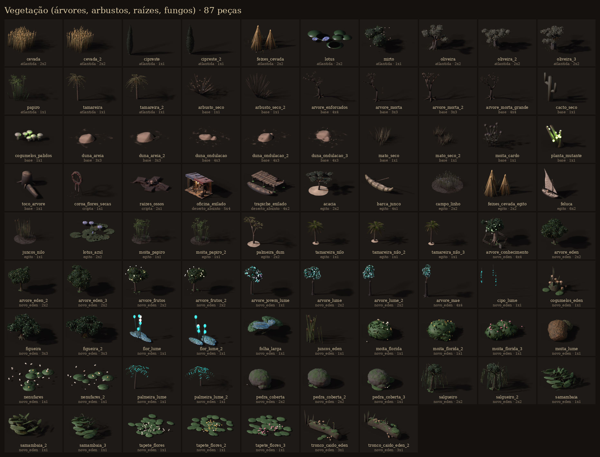

| id | bioma | tiles | o que é |
|---|---|---|---|
| `cevada` | atlantida | 2x2 |  |
| `cevada_2` | atlantida | 2x2 |  |
| `cipreste` | atlantida | 1x1 |  |
| `cipreste_2` | atlantida | 1x1 |  |
| `feixes_cevada` | atlantida | 2x2 |  |
| `lotus` | atlantida | 2x2 |  |
| `mirto` | atlantida | 1x1 |  |
| `oliveira` | atlantida | 2x2 |  |
| `oliveira_2` | atlantida | 2x2 |  |
| `oliveira_3` | atlantida | 2x2 |  |
| `papiro` | atlantida | 1x1 |  |
| `tamareira` | atlantida | 1x1 |  |
| `tamareira_2` | atlantida | 1x1 |  |
| `arbusto_seco` | base | 1x1 | Arbusto seco e espinhento. |
| `arbusto_seco_2` | base | 1x1 |  |
| `arvore_enforcados` | base | 4x4 | Árvore morta grande com cordas de enforcados (Ponte dos Enforcados / bosque). |
| `arvore_morta` | base | 3x3 |  |
| `arvore_morta_2` | base | 3x3 | Árvore morta torta, mais baixa e larga. |
| `arvore_morta_grande` | base | 4x4 | Carvalho morto grande, com corvos. |
| `cacto_seco` | base | 1x1 |  |
| `cogumelos_palidos` | base | 1x1 | Cogumelos pálidos que brilham verde fraco (Bosque das Viúvas). |
| `duna_areia` | base | 3x3 | Monte de areia redondo, com face de queda e ondulação de vento. |
| `duna_areia_2` | base | 3x3 | Monte pequeno que o vento descobriu: costelas de bicho saindo da areia. |
| `duna_ondulacao` | base | 4x3 | Duna baixa e comprida com crista viva; a base some no piso (Mar de Dunas e Estrada do Sul). |
| `duna_ondulacao_2` | base | 4x3 | Barcana: duna em meia-lua, com as pontas apontando para onde o vento vai. |
| `duna_ondulacao_3` | base | 4x3 | Morrinho baixo e firme, com tufos de capim seco e seixos na base. |
| `mato_seco` | base | 1x1 | Tufo de capim seco (espalhe vários pelo mapa). |
| `mato_seco_2` | base | 1x1 |  |
| `moita_cardo` | base | 1x1 | Moita de cardo roxo, a única planta que gosta do Amargo. |
| `planta_mutante` | base | 1x1 | Planta mutante carnuda com pústulas verdes brilhantes. |
| `toco_arvore` | base | 1x1 |  |
| `coroa_flores_secas` | cripta | 1x1 | Coroa de flores de finados num tripé de arame: rosas e cravos secos quase pretos, folhagem de cipreste ressecada e a faixa de luto escrita a tinta… |
| `raizes_ossos` | cripta | 2x1 | Raízes grossas que furaram o piso da catacumba e saíram arrastando ossos e uma caveira presa no meio; lajes levantadas em volta e terra preta. |
| `oficina_exilado` | deserto_absinto | 5x4 | Oficina de Pedro, o Exilado: telheiro de tábuas e troncos sobre um estrado, coberto com lona remendada de duas metades (a lona azul-noite da Vigília… |
| `trapiche_exilado` | deserto_absinto | 4x2 | Trapiche da ilha: tábuas desencontradas sobre estacas de tronco com limo verde do Amargo, uma canoa de casco remendado amarrada, remo, balde e um… |
| `acacia` | egito | 2x2 | Acácia do deserto (a madeira dos barcos e dos sarcófagos): tronco torto, galhos abertos e a copa achatada em guarda-chuva, folhagem miúda verde-cinza… |
| `barca_junco` | egito | 4x1 | Barca de feixes de papiro amarrados (como nas pinturas das mastabas), pontas curvas, vara de impulsionar. |
| `campo_linho` | egito | 2x2 | Canteiro de linho em flor sobre o lodo preto, em fileiras, flores azul-pálidas (o pano das múmias e dos vivos); um rego d'água no meio. |
| `feixes_cevada_egito` | egito | 2x2 | Medas de cevada amarradas no lodo da Terra Negra, prontas para o terreiro. |
| `feluca` | egito | 6x2 | Feluca do Nilo (o barco do barqueiro Ahmose): casco de acácia escuro, a grande vela latina de linho remendado numa verga inclinada, leme de remo,… |
| `juncos_nilo` | egito | 1x1 | Touceira de juncos e taboas da margem, verdes embaixo e secos na ponta, com espigas marrons. |
| `lotus_azul` | egito | 2x2 | Lótus azul (Nymphaea caerulea, a flor de Rá) na água: folhas redondas recortadas e flores azul-pálidas abertas. Decal sobre a água. |
| `moita_papiro` | egito | 1x1 | Moita de papiro do juncal do Nilo: hastes triangulares altas com umbelas abertas, sobre o lodo preto úmido. |
| `moita_papiro_2` | egito | 1x1 | Moita de papiro do juncal do Nilo: hastes triangulares altas com umbelas abertas, sobre o lodo preto úmido. |
| `palmeira_dum` | egito | 2x2 | Palmeira-dum (Hyphaene, a palmeira do Egito que se ramifica em Y): tronco que se divide duas vezes, coroas de folhas em leque e cachos de frutos… |
| `tamareira_nilo` | egito | 1x1 | Tamareira da margem do Nilo: tronco curvo coberto das bases das folhas velhas (escamas em diamante), coroa cheia de folhas-pena com folíolos em V,… |
| `tamareira_nilo_2` | egito | 1x1 | Tamareira da margem do Nilo: tronco curvo coberto das bases das folhas velhas (escamas em diamante), coroa cheia de folhas-pena com folíolos em V,… |
| `tamareira_nilo_3` | egito | 1x1 | Tamareira da margem do Nilo: tronco curvo coberto das bases das folhas velhas (escamas em diamante), coroa cheia de folhas-pena com folíolos em V,… |
| `arvore_conhecimento` | novo_eden | 4x4 |  |
| `arvore_eden` | novo_eden | 2x2 |  |
| `arvore_eden_2` | novo_eden | 2x2 |  |
| `arvore_eden_3` | novo_eden | 2x2 |  |
| `arvore_frutos` | novo_eden | 2x2 |  |
| `arvore_frutos_2` | novo_eden | 2x2 |  |
| `arvore_jovem_lume` | novo_eden | 1x1 |  |
| `arvore_lume` | novo_eden | 2x2 |  |
| `arvore_lume_2` | novo_eden | 2x2 |  |
| `arvore_mae` | novo_eden | 4x4 |  |
| `cipo_lume` | novo_eden | 1x1 |  |
| `cogumelos_eden` | novo_eden | 1x1 |  |
| `figueira` | novo_eden | 3x3 |  |
| `figueira_2` | novo_eden | 3x3 |  |
| `flor_lume` | novo_eden | 1x1 |  |
| `flor_lume_2` | novo_eden | 1x1 |  |
| `folha_larga` | novo_eden | 1x1 |  |
| `juncos_eden` | novo_eden | 1x1 |  |
| `moita_florida` | novo_eden | 1x1 |  |
| `moita_florida_2` | novo_eden | 1x1 |  |
| `moita_florida_3` | novo_eden | 1x1 |  |
| `moita_lume` | novo_eden | 1x1 |  |
| `nenufares` | novo_eden | 1x1 |  |
| `nenufares_2` | novo_eden | 1x1 |  |
| `palmeira_lume` | novo_eden | 1x1 |  |
| `palmeira_lume_2` | novo_eden | 1x1 |  |
| `pedra_coberta` | novo_eden | 2x2 |  |
| `pedra_coberta_2` | novo_eden | 2x2 |  |
| `pedra_coberta_3` | novo_eden | 1x1 |  |
| `salgueiro` | novo_eden | 2x2 |  |
| `salgueiro_2` | novo_eden | 2x2 |  |
| `samambaia` | novo_eden | 1x1 |  |
| `samambaia_2` | novo_eden | 1x1 |  |
| `samambaia_3` | novo_eden | 1x1 |  |
| `tapete_flores` | novo_eden | 1x1 |  |
| `tapete_flores_2` | novo_eden | 1x1 |  |
| `tapete_flores_3` | novo_eden | 1x1 |  |
| `tronco_caido_eden` | novo_eden | 3x1 |  |
| `tronco_caido_eden_2` | novo_eden | 3x1 |  |

## Água, rio e barcos

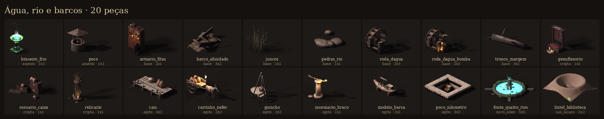

| id | bioma | tiles | o que é |
|---|---|---|---|
| `braseiro_frio` | amenti | 1x1 |  |
| `poco` | amenti | 1x1 |  |
| `armario_fitas` | base | 2x1 | Armário de gravadores de rolo da Central de Escuta: dois decks de fita com carretéis, VU de luz laranja, porta de baixo aberta com caixas de fita,… |
| `barco_afundado` | base | 3x2 | Barco de pesca meio afundado na lama, com remo e rede. |
| `juncos` | base | 1x1 | Juncos e taboas de beira d'água. |
| `pedras_rio` | base | 1x1 |  |
| `roda_dagua` | base | 2x3 | Roda d'água parada no leito seco, com pás quebradas. |
| `roda_dagua_bomba` | base | 2x3 | Roda d'água convertida em bomba a vapor pelos sobreviventes (puxa lama amarga). |
| `tronco_margem` | base | 3x1 |  |
| `genuflexorio` | cripta | 1x1 | Genuflexório de madeira escura com almofada de veludo puída, o terço de contas de osso pendendo e o missal aberto; a cera de anos de velas forma um… |
| `ossuario_caixa` | cripta | 1x1 | Caixas de ossuário empilhadas, com crânios pintados à moda velha (nome, data e uma coroa de folhas na testa), uma tampa aberta mostrando os ossos… |
| `relicario` | cripta | 1x1 | Relicário gótico de latão sobre coluna de pedra: caixinha de vidro com pináculos, um osso de dedo num coxim de veludo, ex-votos de fita amarrados na… |
| `cais` | egito | 4x2 | Cais de madeira das docas de Mênfis: tábuas gastas sobre estacas de palmeira, abitas de amarrar com corda, jarros e um cesto; o lodo preto agarrado… |
| `carrinho_nefer` | egito | 2x2 | O carrinho da aguadeira Nefer nas fogueiras: carroça de duas rodas puxada por um burrico, jarras d'água amarradas, frascos de poção de faiança e a… |
| `guincho` | egito | 2x2 | Cábrea de três pernas sobre um poço de escavação, com sarilho de manivela, corda e o cesto de entulho subindo. |
| `incensario_braco` | egito | 1x1 | Incensário em forma de braço, de bronze verde: cabo de papiro com cabeça de falcão numa ponta e a mão aberta na outra segurando a taça com brasa;… |
| `modelo_barca` | egito | 2x1 | Modelo de barca funerária de madeira pintada do enxoval: casco em lua, olho de Hórus na proa, remadores de madeira sentados, o dono sob o dossel e a… |
| `poco_nilometro` | egito | 3x3 | Nilômetro: poço quadrado de calcário com a escada descendo pelas paredes até a água do Nilo, a escala de côvados gravada na parede e o parapeito… |
| `fonte_quatro_rios` | novo_eden | 5x5 |  |
| `lintel_biblioteca` | sao_lazaro | 2x2 | O poço de areia ao lado da lanterna: a areia abriu um funil e mostra, lá no fundo, o lintel de pedra da porta da Biblioteca com letras gravadas. |

## Rochas, dunas e terreno

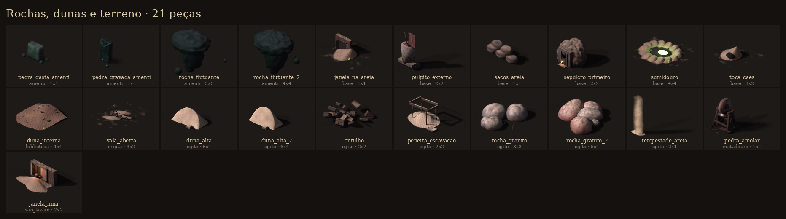

| id | bioma | tiles | o que é |
|---|---|---|---|
| `pedra_gasta_amenti` | amenti | 1x1 |  |
| `pedra_gravada_amenti` | amenti | 1x1 |  |
| `rocha_flutuante` | amenti | 3x3 |  |
| `rocha_flutuante_2` | amenti | 4x4 |  |
| `janela_na_areia` | base | 1x1 | Janela de sobrado aparecendo na areia: entrada para as casas de baixo. |
| `pulpito_externo` | base | 2x2 | Púlpito dos Arautos no adro, de pedra com estandarte e livro acorrentado. |
| `sacos_areia` | base | 1x1 |  |
| `sepulcro_primeiro` | base | 2x2 | O Primeiro Sepulcro: afloramento de rocha com a entrada escavada (vão baixo e escuro), degrau varrido, trilho onde a laje rolou e uma vela no chão da… |
| `sumidouro` | base | 4x4 | O Sumidouro: funil de areia onde o rio some, com brilho verde no fundo. |
| `toca_caes` | base | 3x2 | Toca da matilha: buraco na duna com ossos roídos e trapos. |
| `duna_interna` | biblioteca | 4x4 | A duna que entrou pelo vitral e escorreu até o meio da sala: areia mansa sobre o assoalho, com livros meio enterrados, cacos verdes acesos e páginas… |
| `vala_aberta` | cripta | 3x2 | Vala aberta pela maré de areia, com soldados da Grande Batalha aparecendo. |
| `duna_alta` | egito | 6x4 | Duna alta de areia clara de calcário (borda): barcana com crista afiada em meia-lua, o lado do vento suave e ondulado atrás, a face de escorregamento… |
| `duna_alta_2` | egito | 6x4 | Duna alta de areia clara de calcário (borda): barcana com crista afiada em meia-lua, o lado do vento suave e ondulado atrás, a face de escorregamento… |
| `entulho` | egito | 2x2 |  |
| `peneira_escavacao` | egito | 2x2 | Peneira de escavação: caixilho de madeira com tela, apoiado em cavaletes, o monte de areia peneirada embaixo e os cacos separados numa bandeja. |
| `rocha_granito` | egito | 3x3 | Penedos arredondados de granito da Primeira Catarata, com a crosta escura do deserto e o rosa por baixo. |
| `rocha_granito_2` | egito | 5x4 | Aglomerado grande de penedos de granito da catarata (borda sul), lisos de água e riscados de grafites antigos. |
| `tempestade_areia` | egito | 2x1 | Véu da tempestade de areia do Mar de Areia (borda oeste): cortina de poeira cor de calcário e cobre que sobe do chão e some no alto, com redemoinhos… |
| `pedra_amolar` | matadouro | 1x1 | Esmeril de pedal: rebolo de arenito num cavalete de madeira, bacia de água ferruginosa embaixo, facas esperando a vez. |
| `janela_nina` | sao_lazaro | 2x2 | O quarto da Nina: uma janela de 5º andar na altura da areia, com a veneziana solta, um pano pendurado de cortina, a lata de fogo quase apagada na… |

## Luz e fogo (velas, lampiões, braseiros)

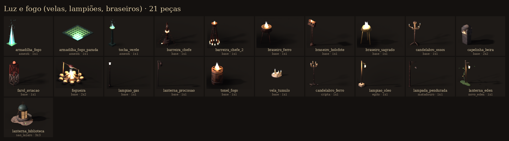

| id | bioma | tiles | o que é |
|---|---|---|---|
| `armadilha_fogo` | amenti | 1x1 |  |
| `armadilha_fogo_parada` | amenti | 1x1 |  |
| `tocha_verde` | amenti | 1x1 |  |
| `barreira_chefe` | base | 1x1 | Estaca de selo: poste de ferro baixo (1,3 m) com anel de runas em brasa, correntes caídas e brasa no pé. Repetida a cada ~1,5 tile em volta da arena,… |
| `barreira_chefe_2` | base | 1x1 | Variação: feixe de lanças cravadas e amarradas, com braseiro de ferro em cima. |
| `braseiro_ferro` | base | 1x1 |  |
| `braseiro_holofote` | base | 1x1 | Holofote de estádio morto virado braseiro: poste de treliça, cabeça de lâmpadas quebradas com fogo dentro. |
| `braseiro_sagrado` | base | 1x1 | Braseiro dos Arautos com chama branca. |
| `candelabro_ossos` | base | 1x1 |  |
| `capelinha_beira` | base | 2x2 | Capelinha de beira de estrada com santo sem rosto e velas. |
| `farol_aviacao` | base | 1x1 | Luz vermelha de aviação num segmento da treliça do mastro: a mesma que ninguém desligou e que pisca fora de ritmo. Conduíte e fita isolante descendo… |
| `fogueira` | base | 2x2 |  |
| `lampiao_gas` | base | 1x1 | Poste de lampião a gás vitoriano, ferro batido, chama quente. |
| `lanterna_procissao` | base | 1x1 |  |
| `tonel_fogo` | base | 1x1 |  |
| `vela_tumulo` | base | 1x1 |  |
| `candelabro_ferro` | cripta | 1x1 | Candelabro de chão de ferro batido com três pés de garra, coroa de sete pontas e velas grossas derretendo, a cera escorrida em estalactites pelos… |
| `lampiao_oleo` | egito | 1x1 | Poste de madeira com a lamparina de óleo num braço de ferro: a luz quente das ruas e acampamentos. |
| `lampada_pendurada` | matadouro | 1x1 | Poste de ferro com braço e lâmpada de filamento numa gaiola de arame, pendurada num fio; luz amarela fraca. |
| `lanterna_eden` | novo_eden | 1x1 |  |
| `lanterna_biblioteca` | sao_lazaro | 3x3 | A lanterna da cúpula da Biblioteca Pública, a única coisa dela que sai da areia: oito colunetas de bronze com janelinhas de vidro (uma arrombada, por… |

## Religioso e funerário (altares, túmulos, estátuas)

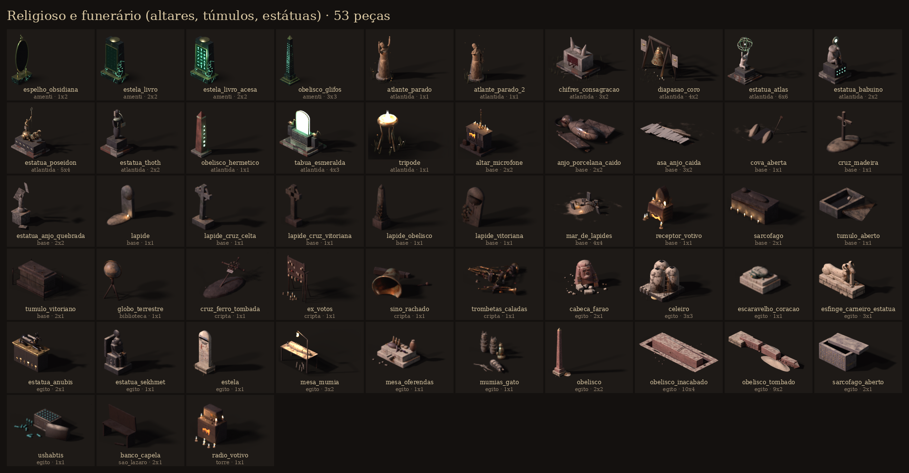

| id | bioma | tiles | o que é |
|---|---|---|---|
| `espelho_obsidiana` | amenti | 1x2 |  |
| `estela_livro` | amenti | 2x2 |  |
| `estela_livro_acesa` | amenti | 2x2 |  |
| `obelisco_glifos` | amenti | 3x3 |  |
| `atlante_parado` | atlantida | 1x1 |  |
| `atlante_parado_2` | atlantida | 1x1 |  |
| `chifres_consagracao` | atlantida | 3x2 |  |
| `diapasao_coro` | atlantida | 4x2 |  |
| `estatua_atlas` | atlantida | 6x6 |  |
| `estatua_babuino` | atlantida | 2x2 |  |
| `estatua_poseidon` | atlantida | 5x4 |  |
| `estatua_thoth` | atlantida | 2x2 |  |
| `obelisco_hermetico` | atlantida | 1x1 |  |
| `tabua_esmeralda` | atlantida | 4x3 |  |
| `tripode` | atlantida | 1x1 |  |
| `altar_microfone` | base | 2x2 | Altar da Congregação: gabinete de transmissor coberto com pano de luto e a marca pintada, microfone de fita no pedestal de latão, velas e rádios… |
| `anjo_porcelana_caido` | base | 2x2 | Estátua angelical de porcelana partida no chão, máscara rachada. |
| `asa_anjo_caida` | base | 3x2 | Asa de anjo gigante caída na areia, penas sujas e tira de couro. |
| `cova_aberta` | base | 1x1 |  |
| `cruz_madeira` | base | 1x1 |  |
| `estatua_anjo_quebrada` | base | 2x2 | Estátua de anjo de pedra caída, asa partida, sobre pedestal. |
| `lapide` | base | 1x1 |  |
| `lapide_cruz_celta` | base | 1x1 |  |
| `lapide_cruz_vitoriana` | base | 1x1 | Cruz celta de pedra com liquen. |
| `lapide_obelisco` | base | 1x1 | Obelisco vitoriano baixo sobre base de cantaria. |
| `lapide_vitoriana` | base | 1x1 | Lápide vitoriana de topo redondo com cruz em relevo, tombada e com hera. |
| `mar_de_lapides` | base | 4x4 | Cemitério de São Lázaro: lápides e cruzes que a duna cobre e descobre. |
| `receptor_votivo` | base | 1x1 | Pequeno santuário da Congregação: rádio de válvula sobre um caixote coberto de pano, as válvulas acesas, velas, fotos dos que "foram sintonizados",… |
| `sarcofago` | base | 2x1 |  |
| `tumulo_aberto` | base | 1x1 |  |
| `tumulo_vitoriano` | base | 2x1 | Túmulo-arca em cantaria com tampa moldada, cercado por grade baixa de ferro batido. |
| `globo_terrestre` | biblioteca | 1x1 | Globo terrestre de 1888 em pé de carvalho, com meridiano de latão; os continentes de antes do Impasse. |
| `cruz_ferro_tombada` | cripta | 1x1 | Cruz de túmulo de ferro batido com volutas e a plaquinha esmaltada do nome, tombada e meio torta sobre um monte de terra, uma guirlanda de arame com… |
| `ex_votos` | cripta | 1x1 | Sala dos milagres: tábua de promessas num cavalete com ex-votos de cera pendurados (cabeças, mãos, pernas, um coração), fotografias desbotadas,… |
| `sino_rachado` | cripta | 1x1 | Sino de bronze caído da torre e rachado, de boca para o lado, com o badalo arrancado, a trave quebrada e a corda podre; verdete por fora e cera… |
| `trombetas_caladas` | cripta | 1x1 | Monte de trombetas de latão caladas: amassadas, as campanas entupidas de pano de luto, amarradas e lacradas com cera vermelha, como os Arautos… |
| `cabeca_farao` | egito | 2x1 | Cabeça de granito de um faraó caída da estátua: toucado nemes listrado com restos de azul e ouro, o nariz quebrado, a barba postiça partida, meio… |
| `celeiro` | egito | 3x3 | Celeiro de silos em cúpula (como nas maquetes dos túmulos): três colmeias de tijolo rebocado com a portinhola de cima para encher e a de baixo para… |
| `escaravelho_coracao` | egito | 1x1 | Escaravelho do coração de pedra verde, do tamanho de um cão, num pedestal de calcário: as asas entalhadas e, na base, o feitiço 30B ("ó meu coração,… |
| `esfinge_carneiro_estatua` | egito | 3x1 | Esfinge de carneiro da avenida de Karnak: corpo de leão, cabeça de carneiro de Amon e, entre as patas, a pequena estátua do faraó de pé protegido por… |
| `estatua_anubis` | egito | 2x1 | Anúbis, o chacal deitado sobre o santuário (como o da tumba de Tutancâmon): madeira com resina preta, orelhas em pé, colar e faixas de ouro gasto; o… |
| `estatua_sekhmet` | egito | 1x1 | Sekhmet, a deusa leoa, sentada no trono: granito preto (das centenas que Amenhotep III pôs em Mut), disco solar com a uraeus, o ankh na mão; o… |
| `estela` | egito | 1x1 | Estela de calcário de topo arredondado: o disco alado no alto, o morto oferecendo a Osíris sentado, e as linhas do 'oferenda que o rei dá' com a… |
| `mesa_mumia` | egito | 3x2 | Mesa de estudo da escavação com uma múmia deitada, metade desenfaixada, ferramentas, lupa, frascos, o caderno de notas e o lampião pendurado em cima. |
| `mesa_oferendas` | egito | 1x1 | Mesa de oferendas (hotep) de calcário com bica: pães cônicos e redondos, figos, um cacho de uva, um ganso depenado, flores de lótus murchas e a jarra… |
| `mumias_gato` | egito | 1x1 | Três múmias de gato de Bubástis em pé, enfaixadas em losango com a cara pintada e as orelhas de linho, e a Bastet de bronze sentada com o filhote;… |
| `obelisco` | egito | 2x2 | Obelisco de granito rosa de Assuã num pedestal: três colunas de hieróglifos em cada face com o cartucho do rei, pirâmide do topo que já foi coberta… |
| `obelisco_inacabado` | egito | 10x4 | O Obelisco Inacabado de Assuã: deitado na pedreira de granito, ainda preso à rocha, rachado de través; a trincheira de batida em volta, as bolas de… |
| `obelisco_tombado` | egito | 9x2 | Obelisco tombado e partido em três pedaços na areia, a ponta longe do pedestal vazio. |
| `sarcofago_aberto` | egito | 2x1 | Sarcófago de granito aberto pela escavação: a tampa empurrada de lado sobre calços de madeira, inscrições do Livro dos Mortos nas faces, a deusa Ísis… |
| `ushabtis` | egito | 1x1 | Caixa de ushabtis em forma de capela, pintada e de tampa caída: dezenas de servidores de faiança azul enfileirados ("aqui estou") e alguns tombados… |
| `banco_capela` | sao_lazaro | 2x1 | Banco de igreja quebrado, madeira escura. |
| `radio_votivo` | torre | 1x1 | Rádio de válvula em cima de um caixote, virado em altar da Congregação: o dial aceso na faixa morta, velas, um fone pendurado, a marca da onda… |

## Ossos, corpos e restos

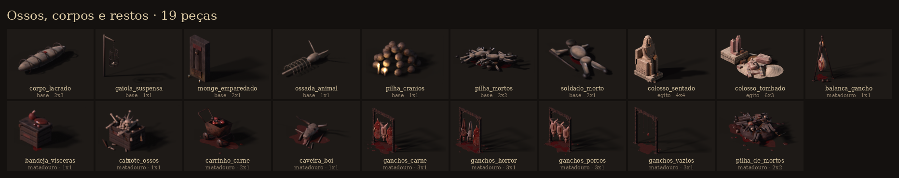

| id | bioma | tiles | o que é |
|---|---|---|---|
| `corpo_lacrado` | base | 2x3 | Corpo lacrado em mortalha costurada com ferro (aguardando o Juízo). |
| `gaiola_suspensa` | base | 1x1 | Gaiola de ferro pendurada num poste, com ossos dentro. |
| `monge_emparedado` | base | 2x1 | Nicho com um monge emparedado (as Carpideiras), parede meio aberta. |
| `ossada_animal` | base | 1x1 |  |
| `pilha_cranios` | base | 1x1 |  |
| `pilha_mortos` | base | 2x2 | Pilha de mortos da Grande Batalha, alimento do Andras. |
| `soldado_morto` | base | 2x1 |  |
| `colosso_sentado` | egito | 4x4 | Colosso sentado de quartzito (como os de Mênon): o rei no trono de bloco, mãos nos joelhos, nemes, rosto roído; nas laterais do trono, o Nilo do… |
| `colosso_tombado` | egito | 6x3 | Ramessés caído ("Ozymandias"): no pedestal ficaram as duas pernas imensas partidas nos joelhos; perto, meio enterrado na areia, o rosto partido olha… |
| `balanca_gancho` | matadouro | 1x1 | Balança de gancho num tripé de vigas: mostrador de latão com ponteiro, pernil pendurado no prato e contrapeso de ferro. |
| `bandeja_visceras` | matadouro | 1x1 | Caixote virado de banco com uma bandeja de zinco amassada: coração, fígado, rins e tripa limpos para a salmoura. |
| `caixote_ossos` | matadouro | 1x1 | Caixote de ripas cheio de ossos de tutano para o caldo do cerco, uma caveira de chifres por cima e o carimbo do Carniça. |
| `carrinho_carne` | matadouro | 2x1 | Carroça de ferro do frigorífico: caçamba rebitada cheia de miúdos e pés de boi, rodas de ferro, alça torta. |
| `caveira_boi` | matadouro | 1x1 | Cabeça de boi esfolada largada no chão: crânio com restos de carne, chifres longos, língua de fora e mandíbula solta. |
| `ganchos_carne` | matadouro | 3x1 | Trilho de ganchos da câmara fria: duas meias carcaças de boi e um porco aberto, correntes, sangue no chão. |
| `ganchos_horror` | matadouro | 3x1 | O que Benedito trouxe do campo da Grande Batalha: um demônio da Legião esfolado, um anjo depenado e um boi. |
| `ganchos_porcos` | matadouro | 3x1 | Trilho com três porcos escaldados pendurados no balancim, barrigas abertas. |
| `ganchos_vazios` | matadouro | 3x1 | Trilho de ganchos vazio: correntes balançando, ganchos sujos e um pedaço de carne esquecido. |
| `pilha_de_mortos` | matadouro | 2x2 | Pilha de Mortos da arena de Andras: soldados da Legião Blasfema e da Vigília amontoados, roídos até o osso, piques quebrados, capacetes com chifres e… |

## Máquinas, rádio, sucata e trilhos

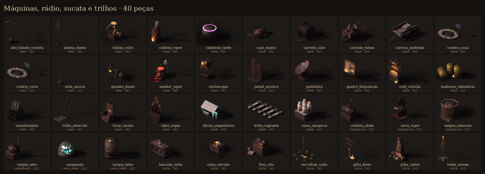

| id | bioma | tiles | o que é |
|---|---|---|---|
| `alto_falante_corneta` | base | 1x1 | Poste de ferro com cacho de alto-falantes de corneta voltados para todos os lados, fios enrolados no poste com fita e base de tambor cheio de… |
| `antena_dipolo` | base | 1x1 | Antena dipolo alta num bloco de concreto: mastro galvanizado com estais, dipolo com isolador central de porcelana, uma yagi torta mais acima, cabo… |
| `bobina_culto` | base | 2x2 | Bobina de Tesla da Congregação, montada sobre um caixote: espiral primária de tubo de cobre, secundária enrolada à mão, toroide de duto amassado… |
| `caldeira_vapor` | base | 2x2 |  |
| `caldeirao_cardo` | base | 2x2 | Caldeirão com caldo de cardo roxo fervendo (alquimia da Vigília). |
| `cano_esgoto` | base | 1x1 | Boca de cano de esgoto do abatedouro despejando lama vermelha no leito. |
| `carretel_cabo` | base | 1x1 | Carretel de madeira com cabo de força enrolado e a ponta caída no chão. |
| `carrinho_tobias` | base | 2x2 | Carrinho de mão de sucata do Tobias, cheio de quinquilharias. |
| `carroca_quebrada` | base | 2x3 |  |
| `cratera_cinza` | base | 2x2 | Cratera de bomba com estilhaços e uma bandeira da Vigília rasgada. |
| `cratera_corte` | base | 2x2 | Cratera de bomba com estilhaços e uma bandeira da Vigília rasgada. |
| `estai_ancora` | base | 1x1 | Ancoragem de estai: bloco de concreto rachado e meio enterrado, chapa de âncora, dois esticadores, grampos e o cabo de aço subindo para fora do… |
| `gerador_diesel` | base | 4x2 | Grupo gerador a diesel: motor de seis cilindros sobre base de aço, volante grande exposto, gerador, radiador, escapamento enegrecido subindo e painel… |
| `moedor_vapor` | base | 6x6 | Porão do Matadouro: o grande moedor de carne a vapor (peça central de sala). |
| `osciloscopio` | base | 1x1 | Osciloscópio de válvula num carrinho de rodinhas: tela laranja com a senoide da faixa morta, ponteiras penduradas, bateria e rolo de cabo na… |
| `painel_acustico` | base | 2x1 | Painéis acústicos de estúdio em pé: moldura de madeira, espuma de pirâmides amarelada, tecido rasgado pendendo e um painel tombado. |
| `parabolica` | base | 3x3 | Parabólica grande e enferrujada na base giratória de concreto e aço, com o alimentador sobre três braços, painéis faltando, cabos descendo e fita do… |
| `quadro_frequencias` | base | 2x1 | Quadro de frequências em pé: cortiça num cavalete de madeira, mapas com curvas de nível, gráficos de sinal, recados e fotos ligados por barbante… |
| `rack_valvulas` | base | 2x1 | Rack de transmissor virado órgão: fileiras de válvulas acesas em degraus como tubos de órgão, tubos de cobre subindo atrás, gabinete de grelhas… |
| `tambores_radioativos` | base | 1x1 | Tambores amarelos de lixo radioativo vazando brilho verde. |
| `transformador` | base | 2x2 | Transformador a óleo: tanque cinza com aletas de radiador, três buchas de porcelana empilhadas, tanque de expansão, placa de perigo e vazamento de… |
| `trilho_retorcido` | base | 1x1 | Trilhos da Linha 7 arrancados e retorcidos para cima. |
| `trono_sucata` | base | 2x2 | Trono de sucata dos demônios no telhado dos fundos da capela. |
| `tubos_orgao` | base | 3x2 | Órgão da Câmara: tubos de latão tortos sobre caixa de madeira, alguns arrancados. |
| `oficina_engenheiros` | egito | 5x4 | Oficina dos Engenheiros Hereges (Dalva Ferraz): bancada de sucata, o gerador de bobinas de cobre com manivela e cabos, e o protótipo da 'lâmpada de… |
| `trilho_vagonete` | egito | 2x1 | Trilho de vagonete Decauville da escavação (bitola estreita) sobre dormentes de madeira na areia. Repete ao longo do eixo X. |
| `vasos_canopicos` | egito | 1x1 | Os quatro vasos canópicos de alabastro com as tampas dos Filhos de Hórus (Imseti homem, Hapi babuíno, Duamutef chacal, Qebehsenuef falcão), sobre a… |
| `caldeira_abate` | matadouro | 2x2 | Caldeira a vapor do frigorífico: corpo de chapa rebitada deitado sobre berço de tijolo, fornalha com a porta entreaberta em brasa, domo de vapor,… |
| `serra_vapor` | matadouro | 2x2 | Serra de fita a vapor para osso: armação de ferro fundido em C, dois volantes com raios, fita dentada, mesa de chapa, pistão e cano de latão com… |
| `tanque_salmoura` | matadouro | 2x2 | Tina de salmoura de carvalho com aros de ferro: água turva com pernis boiando, crosta de sal na borda, remo de madeira e escadinha. |
| `tanque_sebo` | matadouro | 2x2 | Tacho de derreter sebo: caldeirão de chapa rebitada sobre fornalha de tijolo com a boca em brasa, sebo amarelo grosso por cima, escumadeira e chaminé. |
| `campanula` | novo_eden | 1x1 |  |
| `tanque_latao` | novo_eden | 2x2 |  |
| `bancada_solda` | torre | 2x1 | Bancada de radioamador: chassi de transmissor aberto cheio de válvulas e fios, ferro de solda no suporte, rolo de estanho, lupa com lâmpada e o… |
| `caixa_valvulas` | torre | 1x1 | Caixote de válvulas sobressalentes na palha, uma ainda acesa (ligada num fio solto), outras quebradas no chão com o vidro em cacos. |
| `fitas_rolo` | torre | 1x1 | Gravador de rolo da Rádio São Lázaro num caixote: os dois carretéis no tampo, a fita marrom correndo pelas cabeças e escorrendo em laços até o chão… |
| `microfone_caido` | torre | 1x1 | O microfone do sermão: microfone de fita de cápsula cromada num pedestal de ferro, de pé no meio de um anel de velas, a base presa com fita e arame,… |
| `pilha_fones` | torre | 1x1 | Estaca dos fones: um poste de madeira com travessa onde a Congregação pendura os fones de ouvido dos que já não precisam deles, os fios balançando;… |
| `pilha_radios` | torre | 1x1 | Pilha de rádios de todos os tamanhos que a Congregação recolheu nas casas de São Lázaro, empilhados como um relicário: um só ainda acende o dial;… |
| `totem_antena` | torre | 1x1 | Totem da Congregação: poste de cano com antenas de arame dobrado em espiral, latas e colheres penduradas que tilintam, uma válvula acesa no topo como… |

## Móveis (mesas, cadeiras, estantes, camas)

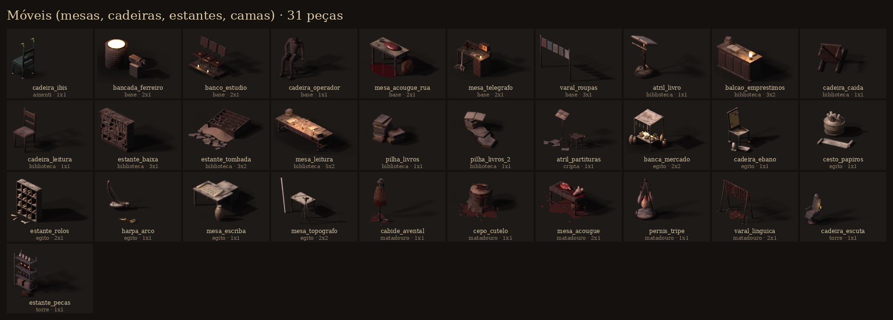

| id | bioma | tiles | o que é |
|---|---|---|---|
| `cadeira_ibis` | amenti | 1x1 |  |
| `bancada_ferreiro` | base | 2x1 | Bigorna, forja pequena e ferramentas (NPC ferreiro do acampamento). |
| `banco_estudio` | base | 2x1 | Fileira de cadeiras de estúdio aparafusadas numa prancha como banco de igreja: vinil rachado, estrutura de tubo, genuflexório na frente e cera… |
| `cadeira_operador` | base | 1x1 | Cadeira giratória de operador com um operador morto, ainda de fones: cabeça caída no peito, um braço pendurado, o fio dos fones descendo até o chão.… |
| `mesa_acougue_rua` | base | 2x1 |  |
| `mesa_telegrafo` | base | 2x1 | Mesa de operador da Central de Escuta: manipulador Morse, sounder de latão, fones, registrador soltando fita de papel que escorre da mesa e se… |
| `varal_roupas` | base | 3x1 |  |
| `atril_livro` | biblioteca | 1x1 | Atril de latão em tripé sobre base de pedra, com o Livro de Horas grande aberto e a fita vermelha caída; faltam páginas no meio. |
| `balcao_emprestimos` | biblioteca | 3x2 | Balcão de empréstimos de Eulália: tampo de imbuia com frente almofadada, livro-registro aberto, carimbo e almofada de tinta, porta-fichas, candeeiro… |
| `cadeira_caida` | biblioteca | 1x1 | A mesma cadeira, tombada de costas no assoalho. |
| `cadeira_leitura` | biblioteca | 1x1 | Cadeira de espaldar da sala de leitura, em carvalho, assento de veludo gasto até o pano. |
| `estante_baixa` | biblioteca | 3x1 | Estante solta de dupla face (1,6 m), de imbuia, com cinco prateleiras; os corredores do Arquivo. |
| `estante_tombada` | biblioteca | 3x2 | Estante solta que tombou na areia: o móvel deitado de lado, prateleiras à mostra e os livros esparramados. |
| `mesa_leitura` | biblioteca | 5x2 | Mesa longa de leitura em carvalho, com trilho de veludo puído, três castiçais acesos, livros abertos, pilhas e um tinteiro; cera escorrida no tampo. |
| `pilha_livros` | biblioteca | 1x1 | Duas pilhas de livros no assoalho, à espera de catalogação, com uma ficha enfiada. |
| `pilha_livros_2` | biblioteca | 1x1 | Pilha alta tombada pela metade, livros escorregando para o chão e um aberto por cima. |
| `atril_partituras` | cripta | 1x1 | Estante de coro de ferro batido com o hinário aberto na antífona do Juízo, partituras rasgadas no chão e uma trombeta calada no banquinho do lado. |
| `banca_mercado` | egito | 2x2 | Banca do mercado de Mênfis: quadro de varas com toldo de linho listrado, mesa com cestos de tâmaras, cebolas, pão em cone, peixe seco pendurado,… |
| `cadeira_ebano` | egito | 1x1 | Cadeira de ébano do enxoval com pés de leão e encosto de folha de ouro gasta, o banquinho dos pés e o apoio de cabeça de alabastro; o assento de… |
| `cesto_papiros` | egito | 1x1 | Cesto de junco cheio de rolos de papiro atados com fita de linho, e um rolo aberto no chão com colunas de escrita hierática e uma vinheta vermelha (o… |
| `estante_rolos` | egito | 2x1 | Estante de nichos da Casa da Vida, de madeira de acácia escurecida, com rolos de papiro amarrados e jarros de guardar rolos; poeira e rolos caídos no… |
| `harpa_arco` | egito | 1x1 | Harpa de arco dos músicos do templo, de madeira com a cabeça de faraó entalhada no pé, cordas de tripa quase todas arrebentadas, e um sistro de… |
| `mesa_escriba` | egito | 1x1 | Mesa do escriba: banco baixo, a paleta de junco com os dois poços de tinta (preta e vermelha), o rolo aberto com colunas de texto, o pote d'água e o… |
| `mesa_topografo` | egito | 2x2 | Posto do topógrafo: teodolito de latão no tripé, mesa com a planta da necrópole presa por pedras, a mira graduada encostada. |
| `cabide_avental` | matadouro | 1x1 | Cabideiro de ferro do magarefe: avental de couro duro de sangue, luvas de borracha, chapéu de feltro e as botas de cano alto largadas embaixo. |
| `cepo_cutelo` | matadouro | 1x1 | Cepo de tronco de casca rachada com aro de ferro, topo de lenho talhado e encharcado, cutelo cravado de fio, um naco de costela e sangue escorrendo… |
| `mesa_acougue` | matadouro | 2x1 | Mesa de desossa: cepo grosso de madeira encharcada e cortada, pés de ferro, cutelos cravados, serrote de osso, pernil a meio desossar, cabeça de… |
| `pernis_tripe` | matadouro | 1x1 | Tripé de ferro com corrente e três pernis curando no sal, um deles já cinzento de bolor; bacia de sal por baixo. |
| `varal_linguica` | matadouro | 2x1 | Varal de defumar: cavaletes de madeira com uma vara de ferro, gomos de linguiça em laço e mantas de charque secando; pingos de gordura e serragem no… |
| `cadeira_escuta` | torre | 1x1 | Cadeira da Escuta: cadeira de dentista velha com correias de couro nos braços, capacete de fones aparafusado no encosto e o cabo que sobe para o… |
| `estante_pecas` | torre | 1x1 | Estante de aço de almoxarifado: vidros de parafusos, rolos de fio de cobre, isoladores de porcelana, caixas de papelão encharcadas e um rádio… |

## Recipientes e cargas (caixotes, barris, vasos)

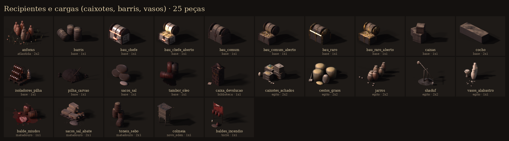

| id | bioma | tiles | o que é |
|---|---|---|---|
| `anforas` | atlantida | 2x2 |  |
| `barris` | base | 1x1 |  |
| `bau_chefe` | base | 1x1 | Baú de chefe: relicário de porcelana e ferro com correntes e brilho vermelho. |
| `bau_chefe_aberto` | base | 1x1 |  |
| `bau_comum` | base | 1x1 | Baú comum (madeira e ferro), fechado. |
| `bau_comum_aberto` | base | 1x1 |  |
| `bau_raro` | base | 1x1 | Baú raro: ferro preto, cantoneiras de latão, selo da trombeta e brilho dourado. |
| `bau_raro_aberto` | base | 1x1 |  |
| `caixas` | base | 1x1 |  |
| `cocho` | base | 2x1 |  |
| `isoladores_pilha` | base | 1x1 | Pilha de isoladores de porcelana num palete: cadeias de disco marrons empilhadas, dois isoladores de pino brancos em pé, cacos quebrados e arame de… |
| `pilha_carvao` | base | 1x1 | Monte de carvão da caldeira, com pá. |
| `sacos_sal` | base | 1x1 | Sacos de sal empilhados, um furado. |
| `tambor_oleo` | base | 1x1 | Tambores de óleo diesel amassados, um tombado vazando, com estêncil apagado. |
| `caixa_devolucao` | biblioteca | 1x1 | Caixa de devolução de ferro rebitado, com fenda escura e placa de latão (DEVOLUÇÕES); areia no tampo. |
| `caixotes_achados` | egito | 2x2 | Caixotes de achados numerados com palha: estatuetas ushabti de faiança, cacos de ostraca, um vaso de alabastro. |
| `cestos_graos` | egito | 2x2 | Cestos de junco com grão (cevada e trigo emmer), um saco aberto, a medida de madeira e a pá. |
| `jarros` | egito | 2x2 | Aglomerado de jarros de barro do Nilo (água, cerveja, grão): ânforas de fundo pontudo encostadas, potes com tampa de barro, um quebrado. |
| `shaduf` | egito | 2x2 | Shaduf: o balde de couro na ponta da vara de balanço, o contrapeso de lodo seco na outra ponta, o cavalete de troncos sobre o barranco de lodo da… |
| `vasos_alabastro` | egito | 1x1 | Vasos de alabastro translúcido do enxoval: a taça em lótus, um vaso de unguento com tampa, uma jarra alta, e os cacos de um que caiu. |
| `balde_miudos` | matadouro | 1x1 | Dois baldes de chapa enferrujada: um cheio de miúdos até a borda, o outro tombado derramando tripa e sangue. |
| `sacos_sal_abate` | matadouro | 2x1 | Sacos de sal grosso de aniagem sobre estrado, carimbo desbotado, um rasgado derramando sal. |
| `toneis_sebo` | matadouro | 2x1 | Tonéis de sebo e de banha: madeira com aros, sebo derramado endurecido, um deitado e aberto. |
| `colmeia` | novo_eden | 1x1 |  |
| `baldes_incendio` | torre | 1x1 | Suporte de baldes de incêndio do mirante: quatro baldes cônicos vermelhos (um caído), areia derramada, a pá e o machado de incêndio na placa, tudo… |

## Cercas, estandartes, placas e sinais

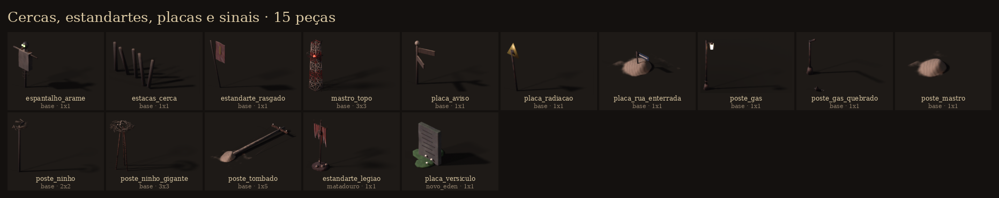

| id | bioma | tiles | o que é |
|---|---|---|---|
| `espantalho_arame` | base | 1x1 | Espantalho de arame e trapos com máscara de gás. |
| `estacas_cerca` | base | 1x1 |  |
| `estandarte_rasgado` | base | 1x1 |  |
| `mastro_topo` | base | 3x3 | O último trecho da treliça do mastro, vermelho e branco descascado, subindo para fora do quadro, com escada de marinheiro e gaiola, cabos coaxiais… |
| `placa_aviso` | base | 1x1 |  |
| `placa_radiacao` | base | 1x1 |  |
| `placa_rua_enterrada` | base | 1x1 | Placa esmaltada de rua de São Lázaro, só o topo para fora da areia. |
| `poste_gas` | base | 1x1 | Poste a gás aceso, ferro fundido gótico. |
| `poste_gas_quebrado` | base | 1x1 |  |
| `poste_mastro` | base | 1x1 | Poste a gás de São Lázaro saindo da areia como mastro de navio afundado. |
| `poste_ninho` | base | 2x2 | Poste com ninho de corvos (galhos, ossos e trapos) e corvos. |
| `poste_ninho_gigante` | base | 3x3 | Torre de ferro com ninho gigante (algo grande mora aqui). |
| `poste_tombado` | base | 1x5 | Poste de concreto tombado com fios e isoladores. |
| `estandarte_legiao` | matadouro | 1x1 | Estandarte partido da Legião Blasfema cravado na pilha: haste quebrada, travessa com pontas de ferro, pano vermelho-sangue em farrapos com o bode… |
| `placa_versiculo` | novo_eden | 1x1 |  |

## Ferramentas e armas

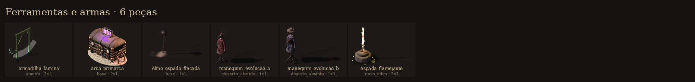

| id | bioma | tiles | o que é |
|---|---|---|---|
| `armadilha_lamina` | amenti | 2x4 |  |
| `arca_primarca` | base | 2x1 | Arca do Primarca: baú tecnomancer do Gustavo (armazém). Carvalho negro, cintas de ferro, volante de cofre, manômetros e cinco válvulas roxas no tampo. |
| `elmo_espada_fincada` | base | 1x1 | Espada fincada na areia com elmo pendurado: túmulo de soldado da Grande Batalha. |
| `manequim_evolucao_a` | deserto_absinto | 1x1 | Manequim dos Arautos na oficina do Exilado: armação de costura vestida com o que um Arauto pode virar no nível 50: sobretudo rubro-negro do Coro,… |
| `manequim_evolucao_b` | deserto_absinto | 1x1 | Manequim da Vigília na oficina do Exilado: armação de costura vestida com o que um combatente da Vigília pode virar no nível 50: guarda-pó azul-noite… |
| `espada_flamejante` | novo_eden | 2x2 |  |
