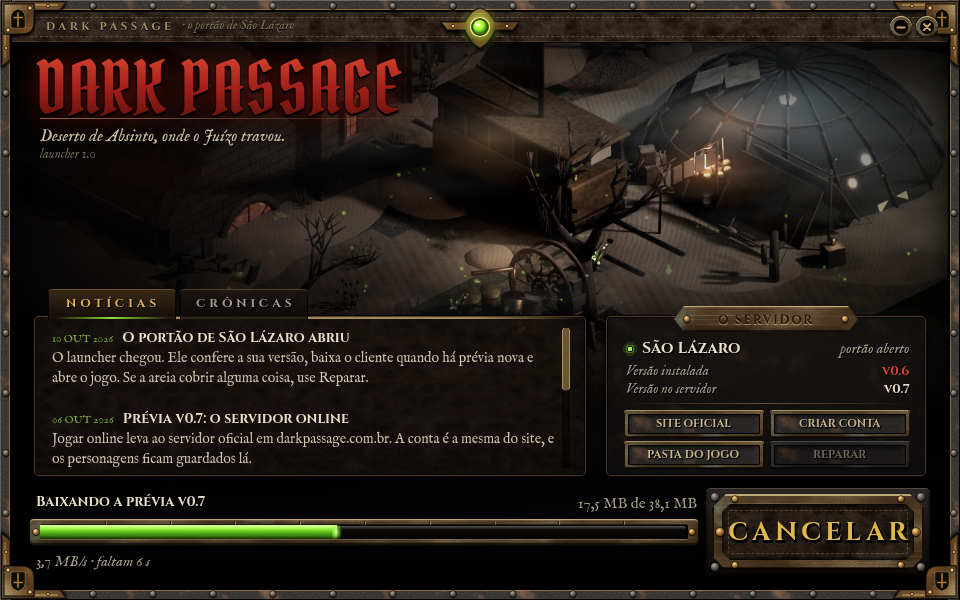

# Launcher do DARK PASSAGE

Janela de entrada no estilo dos MMOs antigos (MU, Dark Eden): notícias e crônicas, versão instalada contra a do
servidor, download e atualização do cliente, botão Jogar e atalhos para o site. Feito em Godot 4.4.1, a mesma engine
do jogo, no visual "Ferrugem Sagrada" (latão, couro e ferro do kit da HUD, cena do Acampamento da Vela, pó do Amargo).



## Como funciona

1. Lê `https://darkpassage.com.br/downloads/cliente.json`, o mesmo arquivo que o site usa:

   ```json
   {"versao": "0.7", "arquivo": "DarkPassage-v0.7-windows.zip", "tamanho": 163660117, "sha256": "..."}
   ```

   Campos opcionais: `executavel` (padrão `DarkPassage.exe`), `url` (endereço do zip, se não for
   `/downloads/<arquivo>`) e `sistema`.
2. Compara com `jogo/versao.json` (gravado pelo próprio launcher depois de instalar).
   - Sem jogo: o botão vira **Instalar** e mostra o tamanho.
   - Versão diferente da do servidor: a atualização começa sozinha.
   - Sem resposta do servidor: dá para jogar a versão instalada (sozinho ou rede local).
3. Baixa o zip para `.baixando/`, confere tamanho e **sha256**, extrai em `jogo.novo/` e só então troca a pasta
   `jogo/`. Um download quebrado nunca deixa o jogo pela metade. **Reparar** baixa tudo de novo.
4. **Jogar** abre `jogo/DarkPassage.exe` e fecha o launcher.

O jogo fica em `%LOCALAPPDATA%\DarkPassage\jogo`, um lugar fixo que não depende de onde o launcher foi aberto
(aberto de dentro do zip, o Windows roda o launcher numa pasta temporária que some, e o jogo era baixado de novo
a cada vez). Uma instalação que já exista em `jogo/` ao lado do launcher, fora de pasta temporária, continua valendo.
Cada prévia nova ainda baixa o zip inteiro (~160 MB): o .exe do jogo leva o pacote embutido, então não há como
baixar só a diferença sem mudar o export do jogo.

Notícias: o launcher tenta `https://darkpassage.com.br/downloads/noticias.json` (mesmo formato de
`dados/noticias.json`, com as listas `noticias` e `cronicas`). Sem ele, mostra as que vêm embutidas. Para publicar
notícia nova sem gerar launcher novo, basta pôr esse arquivo na pasta `downloads` da VPS.

Endereços e nome do servidor ficam em `dados/config.json`.

## Gerar o .exe (na nuvem)

    bash game/tools/instalar_godot.sh            # Godot 4.4.1 + modelos de export
    cd launcher
    /opt/godot/godot --headless --import
    /opt/godot/godot --headless --export-release "Windows" build/DarkPassage-Launcher.exe

O .exe tem ~94 MB (zipado, ~33 MB), quase tudo é o próprio motor do Godot. O ícone do .exe é gravado pelo rcedit
via wine: `apt-get install -y wine`, baixe `rcedit-x64.exe` (github.com/electron/rcedit, v2.0.0) e ponha em
`~/.config/godot/editor_settings-4.4.tres` as linhas `export/windows/rcedit = "<caminho>"` e
`export/windows/wine = "/usr/bin/wine"`.

## Testar sem a VPS

    python3 -m http.server 8768 -d <pasta com downloads/cliente.json e o zip>
    xvfb-run /opt/godot/godot --rendering-driver opengl3 --path launcher -- \
        pasta=/tmp/pc manifesto=http://127.0.0.1:8768/downloads/cliente.json fotos=/tmp/tela.png espera=3

Argumentos (depois de `--`): `pasta=` onde fica `jogo/`, `manifesto=` e `noticias=` trocam os endereços,
`fotos=` salva um print e fecha (com `espera=` segundos).

## Arte

`arte/fontes/pecas.html` desenha todas as peças (fundo, botão Jogar, botões, abas, barra, ícone) com as texturas
de `assets/ui/src/barra/`. Para regerar, na raiz do repositório:

    python3 -m http.server 8767 &
    node launcher/arte/fontes/gerar.js           # grava launcher/arte/pecas/*.png
    python3 -c "from PIL import Image; Image.open('launcher/arte/pecas/icone.png').save('launcher/arte/icone.ico', sizes=[(16,16),(32,32),(48,48),(256,256)])"

Fontes: Cinzel, IM Fell e Pirata One (OFL), as mesmas do jogo. Sons de clique da `assets/audio/sfx/ui`.
